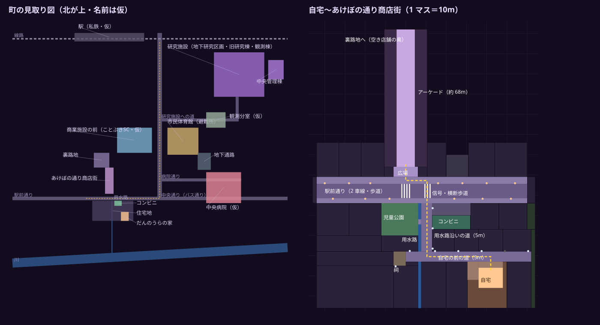

# TOWN_MAP — だんのうらの住む町の配置（フェーズ9・10）

区分：**【提案・仮】**（町の名前・店名・表札・番地はすべて仮。DECISIONS Q4：境界事象の町とは別の町）。
データ：`shinshoku/data/town.js`（`TOWN`＝自宅〜商店街の細かい配置、`MACRO`＝町全体の見取り図）。形は `shinshoku/world/town.js` がデータから作る。
図：`docs/shinshoku/town_map.svg`（`node tools/shinshoku_townmap_svg.mjs` でデータから作り直す）。ゲームの中では一時停止メニューの「地図」。



## 0. フェーズ10 で増えた所（利用者の回答：「自宅は一戸建て。北陸らしさを総曲輪を参考。駅やバス通りも、歩ける場所作ります」）
- **自宅は一戸建てのまま**（確定）。
- **総曲輪（富山市の中心の商店街）を参考**にした雰囲気（意匠は独自・実在の名前・看板・ロゴは使わない・町の名前は出さない）：
  - アーケードを**高いガラスの切妻屋根**（軒 11m・棟 13.4m・細い鉄骨の柱とトラスのアーチ）にした。屋根の下に 3〜4 階の表が見える（古い商家の漆喰と虫籠の格子・タイル・新しいビルのパネルとルーバーが混ざる）。通りの幅（9m）と店の並び・戸・帰路の位置は**物語のために変えていない**。
  - アーケードの東に**ガラスの屋根の広場**「ひかり広場（仮）」（約 25×27m・棟 18.5m・舞台・照明のやぐら・大きな画面・段の席・机と椅子・木・吊りの灯り）。アーケードからは**店の跡の通り抜け**（もとの花屋・休業の札と花のバケツ）、駅前通りからは**屋根つきの入口**。
  - 広場の東から**横丁**（提灯の列・小さな飲み屋の看板）→ **中央通り**へ抜ける。
  - **中央通り（電車通り・バス通り）**：幅 18m の車道（真ん中に**路面電車の軌道**・両側に 2 車線）・両側に 4m の歩道。**架線**（真ん中の柱・電車線と吊り線）、**電停**（線路の両側の島・手すり・屋根・電光の案内）、**バス停**（屋根・時刻表の灯り）、**信号つきの交差点と横断歩道**（駅前通りが突き当たる所・電停の前）、**消雪の水の出口とさびの跡**（車線の真ん中・駅前通りの真ん中も）、**雪囲いの植え込み**・**矢羽根**・側溝のふた・バスの字。止まった路面電車（回送）・止まったバス。
  - 東の空に**高く連なる雪の山脈**（月明かりの雪・特定の山ではない）。
- **駅前を歩ける**：駅舎（ガラスの吹き抜け・両翼・大きな時計・「駅」の灯り・電光「本日の運転は終了しました」）、**大屋根**（ガラスと鉄骨・枝分かれの柱）、**電停 駅前**（路面電車が**輪になって折り返す**線・停まった電車）、**バスターミナル**（島 2 つ・のりば 1〜4・屋根・時刻表）、**タクシーのりば**（車の列・屋根・札）、**駐輪場**（屋根つき）、**時計の塔**、**屋根つきの歩道**（大屋根 → 中央通りの歩道）、線路の輪の中の植え込み（雪囲いの木）。
- 自宅の前の道の東の端も中央通りへつながる（自宅 → 駅は住宅地から直接）。

```
                              北（線路の向こう：研究施設）
   ┌──────────────── 駅舎（中央口・大屋根）──────────────────┐
   │ タクシー  ┌─電停 駅前（線路の輪）─┐   屋根つきの歩道  バスターミナル│
   │ 駐輪場 時計│  植え込み（雪囲い）    │   │             のりば 1〜4   │
   └───────────┴────────┬──────┬────┴───┴────────────────────────┘
  (ビル)  (ビル)  ホテル  │中央通り│  百貨店
   あ ┃  ┌──────┐ 町家    │ 架線   │  茶舗（町家）
   け ┃  │まちなか│ ─横丁─── ═電停═  │  銀行
   ぼ ┃─通り抜け─ ひかり広場  │ (止まった電車) 呉服（町家）
   の ┃  │(ガラス屋根)│ 画廊 │        │  ホテル
   通 ┃  └──入口──┘ 金物 そば│   ║    │
 ═══広場══ 駅前通り ════════════信号╋════横断歩道══ （突き当たり）
   住宅地（自宅・公園・用水路・コンビニ）──自宅の前の道────┘ 中央通りの南（住宅地の東）
                                                     └ この先 通行止め
```

### 0.1 道のり（`TOWN.routes`・通しプレイで実際に歩く）
| 道のり | 道 | 長さ | 曲がり角 |
|---|---|---|---|
| 自宅 → 駅 | 玄関 → 門 → **自宅の前の道を東** → 中央通りの西の歩道を**北**（駅前通りの横断歩道を渡る・バス停）→ 駅前広場を**東** → 大屋根の下を**北** → 駅舎の前 | 約 200m | 5 |
| 駅 → 商店街 | 駅舎の前 → 大屋根 → 駅前広場 → 中央通りの西の歩道を**南** → **横丁を西** → ガラスの屋根の広場 → 店の跡の通り抜け → アーケード | 約 180m | 5 |
| 自宅 → 商店街 | フェーズ9 のまま（約 95m・角 4） | 約 95m | 4 |

- まっすぐには行けない（家・ビル・広場の建物が間にある）＝`tests/shinshoku-p9.test.mjs`。
- **線路は歩くのを塞がない**（平らな埋め込みの軌道）。塞ぐのは止まった電車・架線の柱・電停の手すりと屋根の柱だけ。電停の島（0.24m）は歩いて上がれる。

### 0.2 場所（区画 `shotengai` の座標・m）
| 場所 | 範囲（x, z） | 備考 |
|---|---|---|
| 店の跡の通り抜け | x 4.5〜10.6・z −28〜−22 | もとの花屋（`data/level.js` の `passage`）。上は 2・3 階の建物 |
| ガラスの屋根の広場 | x 10.6〜36・z −34〜−6.5 | 軒 15.5m・棟 18.5m。入口（駅前通りから）x 20〜26・z −6.5〜1 |
| 横丁 | x 36〜66・z −24〜−19.5 | 提灯・電柱 3。P13：南の側（x 44〜60・z −19.5〜−15.1＝n7 の区画の裏）に飲み屋の長屋 4 軒（焼き鳥・おでん・立ち飲み・スナック 雪：戸口から店の中が見える）。北の提灯は居酒屋のひさしから吊る |
| 中央通り | 車道 x 70〜88・歩道 x 66〜70／88〜92・z −78〜46 | 線路 x 77.75／80.25（軌間 1.067m）。電停 z −46〜−30。南の端 z 46 は通行止め |
| 駅前広場 | x 40〜116・z −112〜−78 | 大屋根 x 50〜110・z −112〜−98.4（高さ 9.2m） |
| 駅舎 | x 44〜116・z −128〜−112 | 吹き抜け x 70〜88（高さ 17.5m）。中には入れない（運転終了） |

### 0.3 見た目・軽さ
- 遠い所（中央通り・駅前・中央通りに面した建物）は**最初のこまの後で組み立てる**（起動を速く。当たり判定は最初から全部ある）。
- 町の材質は 2 つ（tex・texglow）にまとめた（頂点色だけの箱・光る箱・暗いガラス・シャッターも地図帳の白い枠などで描く）＋看板・透けるガラス。長い箱は升目の半分ずつに分ける（遠くの升目の網が広がらない）。
- 霧で見えない所は描かない（霧の濃さからカメラの奥を決める。スマホの「低」はさらに 0.8 倍）。

### 0.4 P13（環境の点検）で動かした物・足した物
- 用水路沿いの道の電柱 3 本：x 13.3 → **12.8**（前はコンビニの壁にめり込んでいた）。隠れ場所 [13.8, 26.5] → [12.3, 27.2]。
- 止まった車（前は「コインパーキング」＝広場の入口の通路で店の壁にめり込んでいた）→ **コンビニの駐車場**の枠（x 24.95・z 17.4）。
- 止まった路面電車（tram1）：z −38 → **−40**（架線の柱 z −32 に重ならない）。
- 町の縁の外（x < −46・z > 66・x > 118・駅の裏 z < −128）と中央通りの東の区画の奥（x 108.6〜117.8）に**遠景の家並み**（見えるだけ・当たり判定なし）。駅前通りの西の突き当たり（z 0.6〜14.4）は閉じた店の表。

## 1. なぜ変えたか
フェーズ8 までは「自宅の玄関を出る → 10m の路地 → そのままアーケード」というまっすぐの一本道だった（利用者の指摘：「家から出たら直線上に商店街はあるわけない」）。
フェーズ9 では、ふつうの地方都市（北陸の町の雰囲気をにおわせる程度・場所は決めない）の並びにした：

```
                     北（駅の方）
        ┌──────────── あけぼの通り商店街（アーケード・約 68m）────────────┐
        │  … 空き店舗の奥 → 裏路地 → 商業施設の前 → 市民体育館 …            │
        └───────────────────────┬──[広場]──┬────────────────────────────┘
  ビル・不動産・クリーニング取次  │   たばこ  │ たい焼き   居酒屋・英会話  P  信用金庫  金物
 ════ 北の歩道（インターロッキング・電柱と高い街灯）════════════════════════════════
 ════ 駅前通り（2 車線・中央の破線）══════[横断歩道]════[信号の交差点]═══════════
 ════ 南の歩道（ガードレール）════════════════════════════╤══════════════════════
   家  理容(閉)  ┃児童公園┃≈≈用水路≈≈│用水路沿いの道│コンビニ（駐車場）  アパート  家
                 ┃ 橋 ═══╋≈≈≈≈≈≈≈≈≈≈│   (5m)       │家 家 家 家（表は南）
   (奥の家並み)  家（表は東）≈≈≈≈≈≈≈≈│ 止まれ        │
        祠 ⛩ ─────────────── 自宅の前の道（5m・歩道なし・側溝）──────── 田んぼ
            家（西村）≈≈ 家（佐藤）  家（吉岡） [だんのうらの家・カーポート]  家（岡本）
                     南
```

## 2. 自宅 → 商店街の道のり（データ `TOWN.route`・通しプレイで実際に歩く）
| 区間 | 道 | 長さ | 向き |
|---|---|---|---|
| 玄関 → 門 | 前庭（飛び石・植木鉢・娘の補助輪つき自転車） | 約 7m | 北 |
| 門 → 用水路沿いの道の角 | **自宅の前の道**（幅 5m・歩道なし・両側に側溝のふた・電柱と小さな街灯・ごみ集積所・自販機・カーブミラー） | 約 32m | **西（角 1）** |
| 角 → 駅前通り | **用水路沿いの道**（幅 5m。西に用水路と手すり・公園への小さな橋・止まれ・通学路の標識・雪国の矢羽根） | 約 28m | **北（角 2）** |
| 交差点 | **信号つきの横断歩道**（車の信号 2・歩行者の信号 2・押しボタン箱。信号は 22.5 秒でめぐる） | 約 10m | 北 |
| 北の歩道 | 駅前通りの歩道（バス停・コインパーキング・居酒屋の灯り） | 約 10m | **西（角 3）** |
| 広場 → アーケード | 駐輪の自転車・アーチの看板「あけぼの通り商店街」 | 約 9m | **北（角 4）** |
| **合計** | | **約 95m・角 4 つ** | 歩いて約 45 秒・走って約 19 秒（ゲームの都合で縮めた 2〜3 分の道） |

- 道案内：ミニマップの目標（黄色のひし形）は、同じ区画の中では `TOWN.nav`（交差点の点）を道なりにたどり、次に曲がる角を指す（距離は最後の目標まで）。
- まっすぐ北へは行けない（家・塀・用水路・コンビニが間にある）＝テスト `tests/shinshoku-p9.test.mjs` で確かめる。

## 3. 場所と距離（区画 `shotengai` の座標・m。x＝東、z＝南）
| 場所 | 範囲（x, z） | 備考 |
|---|---|---|
| アーケード（商店街） | x −4.5〜4.5・z −72〜−4 | 前と同じ座標（帰路・閉店・相棒・演出の位置は変えていない） |
| アーケード前の広場 | x −6〜6・z −4〜1 | 駐輪の自転車・アーチ |
| 駅前通り（北の歩道・車道・南の歩道） | z 1〜4.5 ／ 4.5〜11.5 ／ 11.5〜14（x −44〜60） | 両端は「この先 通行止め」 |
| 信号の交差点 | x 8.6〜12.4（横断歩道） | 用水路沿いの道の正面 |
| 用水路沿いの道 | x 7.6〜13・z 14〜38 | 用水路 x 6.2〜7.6（深さ約 0.9m） |
| 自宅の前の道 | x 0〜62・z 38〜43 | 西の端に祠、東の端は田んぼ |
| 児童公園 | x −12〜6.2・z 14〜30 | ぶらんこ・すべり台・砂場・ベンチ・トイレ・木。入口は歩道側と橋 |
| コンビニ | 建物 x 13〜32・z 20〜27、駐車場 z 14〜20 | 24 時間（人はいない） |
| **だんのうらの家** | 区画 x 30.5〜50・z 43〜66。家 x 36〜48・z 46〜56（2 階建て・瓦） | `HOME_O`＝(42, 40) を家の中のローカル座標に足す |

## 4. 町全体（`MACRO`・おおよそ）
| 場所 | 区画 id | 自宅からのおおよその道のり | つながり（ゲーム） |
|---|---|---|---|
| あけぼの通り商店街 | shotengai | 約 95m | 住宅地と同じ区画 |
| 裏路地 | alley | 商店街の奥（約 180m） | 空き店舗の奥 |
| 商業施設の前（ことぶきSC・仮） | plaza | 約 300m | 裏路地の表通り |
| 市民体育館（避難所） | shelter | 約 400m（中央通り・バス通り） | 商業施設の前 |
| 中央病院（仮） | hospital | 約 450m（病院通り） | 体育館・地下通路 |
| 地下通路 | tunnel | 病院の地下 → 体育館 | — |
| 観測分室（仮） | office | 約 500m | 体育館 |
| 研究施設（地下研究区画・搬入ヤード・旧研究棟・観測棟） | lab ほか | 約 700m（線路の手前・研究施設への道） | 観測分室の地下 |
| 中央管理棟 | admin | 研究施設の奥 | 観測棟の連絡橋 |
| 駅・駅前広場（仮） | shotengai | 約 200m（中央通りの北の端） | **歩いて行ける**（フェーズ10） |
| 中央通り（電車通り・バス通り） | shotengai | 約 30m（自宅の前の道の東の端） | **歩いて行ける**（フェーズ10） |

## 5. 配置の直し方（データ駆動）
- 道・歩道・広場：`TOWN.walk`（四角）。区画（家・店）：`TOWN.lots`（`kind`・`face`＝表の向き・`wall`／`roof`＝材質・`name`＝表札・`sign`＝看板）。
- 電柱と街灯：`TOWN.poleLines`（点の列。電線は順につなぐ。`deadLamps`＝切れた灯・`flickerLamps`＝ちらつく灯）。小物：`TOWN.props`、道の印：`TOWN.marks`。
- 当たり判定は `townSolids()` がデータから作る（家の区画は塀の高さ、建物は 7.5m）。**歩ける所の周りは必ず塞ぐ**（テストが「町の外へ出られない」を確かめる）。
- 道のりを変えたら `TOWN.route`・`TOWN.nav` も直す。テスト：`node tests/shinshoku-p9.test.mjs`。図：`node tools/shinshoku_townmap_svg.mjs`。
- **出入り口（フェーズ11）**：建物の区画（`BUILDING_KINDS`＝家・店・ビル・集合住宅・コンビニ・町家・百貨店・駅舎・自宅）は `lotEntrances(L)` が出入り口（玄関・ガラスの戸・シャッター・自動ドア・門）の位置を返し、`world/town.js`・`town2.js` も同じ関数から戸を置く。家の玄関は `houseDoor(L)`（`L.door`＝`'L'`｜`'R'` で決められる。無ければ id の乱数）＝**門の切れ目と同じ位置**。町家の戸口は `machiyaDoors(L)`、百貨店の自動ドアは `deptDoorsU(L)`（`L.doorsU` で決められる）。奥の家並み（`fill`）・奥のビル（`fillB`）は `fillCells(L)` の升目ごとに、道に面した面へ `fillEntrances(L)` が戸を置く（細い区画は狭い家、2.5m 未満は塀だけ＝見えない壁を作らない）。
  - **出入り口の前に物を置かない**：区画の縁から 0.6m 外が歩ける所（`isWalkable`）で、電柱・自販機・車・バス停などの当たり判定に塞がれていない（`blockedAt`）こと。テスト：`node tests/shinshoku-p11.test.mjs`。
  - フェーズ11 の直し：区画の id の重なりを直した（用水路の西の家 `w1`→`cw1`（石井）・`w3`→`cw3`（西村））。石井さんの家は用水路に面するので**家の前に小さな橋**（`walk` の `bridge2`・用水路の柵の切れ目 z 34.7〜36.3）。西村さんの玄関は祠の角の側。コンビニの自販機を自動ドアの前から西へ、上田さんの門をごみ置き場の前から東へ、まちなかビルの自動ドアを舞台の両脇へ、中央通り東の街灯を集合住宅の入口の前から南へ移した。

## 6. 古いセーブ
- セーブの版は 1 のまま。`place.layout`（今は `town3`）を新しく書く。
- `town2`（フェーズ9）のセーブ：歩ける所は増えただけなので、位置はそのまま。新しい物（信号の柱・街灯など）に重なった時だけ、いちばん近い道案内の点へ移す（`migrateTownPos(pos, 'town2')`）。
- layout の無い商店街のセーブ（フェーズ8 まで）は、読む時に位置だけ移す（`migrateTownPos`）：
  - 家の中（旧 z 6〜16）→ 新しい自宅の同じ家具の前（ローカル座標のまま）
  - 家の前の路地（旧 z −4〜6）→ アーケード前の広場（0, −2）
  - アーケードの中 → そのまま
- 段・旗・敵の決着・拾った物はそのまま（id は変えていない）。

## 7. 見た目（フェーズ9 のグラフィック）
- 町の地図帳（`render/townmat.js`）：2048×1536 のキャンバスに 48 枠（アスファルト・補修跡・インターロッキング・縁石・ブロック塀・サイディング 2 種・モルタル・タイル・板壁・瓦 2 種・トタン・窓 7 種（枠・カーテン・障子・点いた窓・事務所）・玄関扉・シャッター・コンビニの棚・止まれ・独自柄のマンホール・金網・生垣・田んぼ・水面・水たまり・落ち葉など）。**1 つの材質で全部描ける**（枠の中を繰り返す小さなシェーダー）。
- 広い区画は 40m の升目ごとに網を分ける（画面の外の升目は描かない）。
- 夜：街灯の下の光のたまり（足し合わせの円 1 回）・濡れた路面の光の筋・雨（アーケードの中・家の中・カーポート・コンビニのひさしの下は降らない）・霧（アーケードは濃く住宅地は少し薄い）・遠い山なみ（雪の残る稜線）と雲と星。
