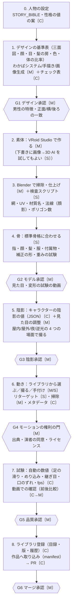
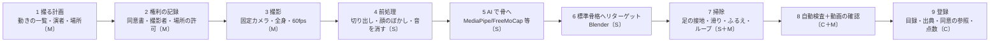

# 03 制作フロー

キャラクター 1 体を「デザイン → モデル → 掃除 → 骨 → 陰影 → 動き → 試験 → ライブラリ登録」まで通す流れ。
担当の記号は mapkit と同じ：**〔C〕クラウドの AI（Claude Code など）／〔S〕利用者の PC で動かすスクリプト／〔M〕人の手作業・判断**。
承認の門（**G1〜G6**）は人が通す。AI は門を通さない。

---

## 1. 全体の流れ

- 各段の出力は**ファイル**で残し（`06` のフォルダ構成）、次の段はファイルだけを見る（人と AI の受け渡しをはっきりさせる）。
- **やり直しは段ごとに最大 3 回**（`08` §3）。3 回で通らなければ人が方針を決める（無限の作り直しをしない）。

---

## 2. 段ごとの中身

### 2.1 デザインの基準表（`11` §3 に項目の一覧）
- 正面・横・後ろ（＋斜め 3/4）の全身、顔の正面・横、目の拡大、髪の房の分け方、服の展開、色見本（色番号）、身長の線（頭身）、付属物の拡大。
- 〔C〕がチェック表（`tools/charkit/sheet_check.md`・フェーズ 1）を作り、〔M〕が埋める。画像の整合（正面と横で髪の房の数・服の線の高さが同じか）は**人が見る**（AI は指摘の補助まで）。
- 画像生成 AI・わかばシステムを使う時は、**使った道具・版・規約・入力（参考にした画像）を記録**（mapkit `07` §3 の `source.aiModel`）。**他の作品のキャラクターの画像を入力にしない**。

### 2.2 素体（VRoid Studio）
- VRoid の体型の値（身長・肩幅・胸・腰・首・手足の大きさ）を、三面図の数値に合わせる（だんのうらの値は `06` §7）。
- 書き出しの設定：**VRM 1.0**／材質の数を減らす（テクスチャの地図帳）／ポリゴンの削減は控えめ（掃除で行う）。具体的な画面の項目名は版で変わるので**利用者の画面で確認**（未確認）。
- 素のままだと「VRoid らしい顔」になりやすい → 目・眉・口の絵は 2.1 の基準表から**描き直す**（VRoid のテクスチャ編集 or Blender／画像ソフト）。

### 2.3 Blender での掃除・仕上げ（画像 → 3D AI の網を使う場合は**必須**）
| 検査・作業 | 自動〔S〕 | 人〔M〕 |
|---|---|---|
| 縮尺（m）・向き（+Z 前は書き出しで）・原点（足元の中央） | 検査して直す | – |
| 網の穴・裏返った面・重なった頂点・左右対称のずれ | 検査・報告 | 直す |
| リトポ（AI の網の場合）・関節の周りの輪の数（ひじ・ひざは 3 本以上） | 数を数える | 作り直す |
| UV の重なり・テクスチャの解像度（2048 以下） | 検査 | 直す |
| 材質の名前の規則（`06` §4：`skin`・`hair`・`cloth_*`・`metal_*`・`eye_*`・`face`） | 検査 | 名前を付ける |
| 顔の法線の転写（顔影）・SDF の影の地図の生成 | スクリプト（`tools/charkit/blender/face_normals.py`・`face_sdf.py`） | 見た目の判断 |
| 三角形の数（主人公 3〜5 万）・骨の数 | 検査 | 減らす |

### 2.4 骨（`06` §3 の標準骨格）
- VRM の humanoid を本体、`ext_` の規則で髪・服・付属物・尾・耳の骨。
- 重みの試験：決まった**変形試験のポーズ集**（肩 90°・腕を前へ 120°・ひじ 140°・股 90°・ひざ 140°・しゃがみ・体のねじれ 45°・手首 70°・指を握る）を当てて画面撮影（`tools/charkit/blender/deform_test.py`）。
- 補正の形（肩・ひじ・股・ひざ）を作り、骨の角度との対応を JSON に（`06` §5 `correctives`）。

### 2.5 陰影
- キャラクターの陰影の値（`06` §5 `shader`）を 4 つの決まった場面（屋内の蛍光灯・昼の屋外・夜の街灯・逆光）で撮って比べる（`tools/charkit/lookdev.html`・フェーズ 3）。

### 2.6 動き（§5 の動画から作る流れ、§4 の分類）

### 2.7 試験（`13`）
- 自動：足の滑り・めり込み・継ぎ目のはね・口のずれ・fps・GPU のメモリ・描画呼び出し。
- 動画：決まった場面・決まったカメラ・決まった入力の動きを**こま送りで撮って**動画にする（`13` §4）。前と後を横に並べる。

### 2.8 ライブラリ登録
- モデル：mapkit の素材の目録（`category: character`）に登録。
- モーション：`07` の目録に登録（出典・権利・品質の点数・履歴）。
- 作品へ：`shinshoku/assets/characters/manifest.json` に書く（今の仕組みのまま）。

---

## 3. 共通（基盤）と作品専用の分け方
| 共通（`charkit/`・全作品で使う） | 作品専用（`shinshoku/` など） |
|---|---|
| 標準骨格・骨の対応表・読み込み・混ぜる係・IK・視線・口・揺れ物・陰影の仕組み・検査・動画の撮影・目録・権利の門 | 人物（だんのうら・相棒）・性格の値の中身・戦闘のこまの数字・物語・画風の細部（色の値）・どのモーションを使うか |
| 性格の値の**形（スキーマ）** | 性格の値の**数値** |
| 戦闘モーションの「こまの検査」の仕組み | `data/combat.js` の数字 |

---

## 4. モーションの入手先の分類
| 種類 | 例 | 権利 | 使い方 |
|---|---|---|---|
| 自作（手付け） | Blender で付けた戦闘・表情 | 自分 | そのまま |
| 自作（撮影） | 利用者や許可を得た人が演じた動画 → AI で骨へ | 演者の同意が要る | §5 の流れ |
| CC0・自由な素材 | （候補は利用者の PC で探す。本環境から素材サイトは開けない） | 規約を人が確認 | ライセンス門を通す |
| 既製（Mixamo など） | – | **素のファイルの再配布は不可**の規約 → Web 配信は要確認 | 試しだけ／UE の PC 版なら cook される |
| 購入（Fab 等） | – | Fab Standard License（Web 配信は要確認・mapkit `04` §3） | 当面は使わない |
| 研究用の AI の出力 | GVHMR など | 非商用＋SMPL | **作品に入れない**（比較のみ） |

---

## 5. 動画から AI でモーションを作る流れ（手順 1〜9・権利の管理つき）

| 手順 | 中身 | 担当 | 残す物 |
|---|---|---|---|
| 1 | 撮る動きの一覧（`07` の名前の規則で）。1 本 5〜20 秒・はじめと終わりに 1 秒の静止 | M（一覧の案は C） | `shotlist.json` |
| 2 | **演者の同意**（誰が・何の作品に・どこまで使うか・取り消し）、撮影した人、場所の許可。**他人の映像・テレビ・ゲーム・SNS の動画は使わない** | M | `rights/<撮影 id>.json`（個人の名前は利用者の判断で伏せる）。原本の同意書は NAS など**公開しない場所** |
| 3 | 固定の三脚・全身が入る・明るく・体の線が分かる服・60fps（無理なら 30fps）。複数の Web カメラなら FreeMoCap の校正板 | M | 元の動画（NAS・**Git に入れない**） |
| 4 | 区間の切り出し・**顔のぼかし（公開する時）**・音を消す（声の権利を分ける） | S（ffmpeg） | 切り出した動画（NAS） |
| 5 | AI で骨の動きへ（MediaPipe Pose → 自作の変換／FreeMoCap → BVH） | S | BVH（NAS） |
| 6 | Blender で標準骨格へ（骨の対応表・`06` §3） | S | `.blend`（NAS） |
| 7 | 足の接地の印を付けて滑りを消す・手のふるえを減らす（フィルタ）・ループの継ぎ目・根の動き（root motion）の抽出 | S＋M | `.glb`／`.vrma`（書き出し） |
| 8 | 自動検査（`13`）＋動画で人が見る | C＋M | 検査のレポート・動画 |
| 9 | 目録に登録（出典＝撮影 id・同意の参照・使った AI と版・点数・履歴） | C | `07` の meta.json |

**権利の門（G4）で止める条件**（mapkit `07` §3.1 のライセンス門に足す・`07` §4）：同意の記録が無い／出典が「不明」／演者が未成年で保護者の同意が無い／他人の映像／研究用の AI（非商用）を通した物を作品の本番に使う／SMPL などの模型を通していて商用の許可が無い。
