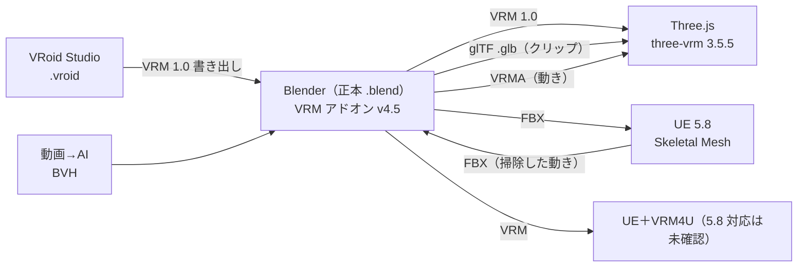

# 04 Unreal Engine 連携方式（と Web の実行の道）

**2026-10-17 の利用者の決定：方式 A・B・C を全部採用**（ブラウザ版を続け・UE5 の高性能 PC 版も作り・素材置き場は共有。`docs/wakaba-mapkit/10`）。キャラクターでの進め方は §6。
（以下 §1〜§5 は決定の前に書いた比較。記録として残す。元の書き出し：「UE の採用は決めていません。mapkit の方式の質問（Q-A2）にはまだ答えをもらっていない」）

---

## 1. 方式ごとのキャラクターの扱い

| | **A：Three.js が本番**（UE・Blender は道具） | **B：UE だけ** | **C：両方**（UE で PC の高品質版＋Three.js で Web 版） |
|---|---|---|---|
| モデルの正本 | `.blend`（Blender） | `.blend` → FBX → UE の資産 | `.blend`（両方へ書き出す） |
| 実行時のモデル | **VRM 1.0（.vrm）**／glTF（.glb） | UE の Skeletal Mesh | 両方 |
| 陰影 | 独自のトゥーン（Three.js のシェーダー・`14` §4.7） | UE の材質（独自のトゥーン・ポストプロセス） | **2 回作る**（値の JSON は共通・見た目は近づけるだけ） |
| 動き | `AnimationMixer`＋自作の混ぜる係・IK・視線・口 | Animation Blueprint・Motion Matching・Control Rig・Motion Warping | Web は A、PC は UE |
| 揺れ物 | VRM SpringBone | Chaos Cloth・（VRM4U の SpringBone は 5.8 で動くか未確認） | 両方 |
| 試験 | クラウドの Claude が自動で（Playwright・こま撮り） | **利用者の PC だけ**（Movie Render Queue・Gauntlet などは未調査） | 両方 |
| 長所 | 既存の境界侵食・試験・スマホ・Pages がそのまま | 動きの品質の上限が最も高い（Motion Matching・物理） | 両方の長所 |
| 短所 | Motion Matching・布の物理は自作で重い | 作り直しが大きい・スマホを失う・AI の自動試験ができない | 手間が 2 倍 |

**推奨（mapkit と同じ）**：**まず A**。キャラクターでは、UE は「**Motion Matching・Chaos Cloth の品質を見る短い試し**」と「**動きの掃除の道具（IK Retargeter）**」として使う価値がある。C に進むかは試しの結果と、mapkit の Q-A2 の答えで決める。B は勧めない。

---

## 2. 受け渡しの形式

| 物 | 形式 | 注意 |
|---|---|---|
| 人型のモデル（Web） | **VRM 1.0**（中身は glTF 2.0＋拡張） | 向き +Z・T ポーズ・m。表情・視線・SpringBone・MToon が入る。三角形・材質の数は `10` の予算 |
| 人型のモデル（UE） | FBX（Blender の FBX 書き出し） | Blender は Z が上・UE は Z が上・cm。**縮尺 0.01／1.0 の設定で 100 倍のずれが起きやすい**（書き出しは固定の bpy スクリプトで） |
| 動き（Web） | **VRMA**（VRM Animation：humanoid の回転・hips の移動・表情・視線）か glTF のクリップ | VRMA は three-vrm-animation で読める（npm `@pixiv/three-vrm-animation` 3.5.5・MIT【確認済】）。**本作は今これを同梱していない**（`vendor/three-esm/` に足す必要・フェーズ 2） |
| 動き（受け渡し） | **BVH**（動画 AI の出力）／FBX（UE・Mixamo） | BVH は骨の名前・向きが道具ごとに違う → Blender で標準骨格へ |
| 動き（UE → Web） | UE で掃除 → FBX → Blender → VRMA／glb | UE の Motion Matching の**仕組み自体は持ち出せない**（素材だけ） |
| 表情の曲線（UE） | モーフの名前を揃える（`06` §4） | UE 5.8 の IK Retargeter で「全部の曲線を写す」設定が値を壊す不具合の報告あり（明示の対応表で回避）【検索要約】 |

---

## 3. 骨の対応表（標準骨格 ⇔ 各方式）

標準骨格＝**VRM 1.0 の humanoid の名前**（`06` §3）。下は主な骨。指は同じ規則で `Thumb/Index/Middle/Ring/Little` × 3 本。

| 標準（VRM 1.0） | 境界侵食の今の 17 本 | UE5 マネキン（Manny） | Mixamo | Blender Rigify（変形の骨） |
|---|---|---|---|---|
| hips | hips | pelvis | mixamorig:Hips | DEF-spine |
| spine | spine | spine_01（＋spine_02） | mixamorig:Spine | DEF-spine.001 |
| chest | chest | spine_03（＋spine_04） | mixamorig:Spine1 | DEF-spine.002 |
| upperChest | （無し→chest） | spine_05 | mixamorig:Spine2 | DEF-spine.003 |
| neck | neck | neck_01（＋neck_02） | mixamorig:Neck | DEF-spine.004 |
| head | head | head | mixamorig:Head | DEF-spine.006 |
| leftEye／rightEye | （無し） | （無し・FACS 側） | （無し） | （顔のリグ） |
| jaw | （無し） | （無し・MetaHuman は別） | （無し） | DEF-jaw |
| leftShoulder | （無し） | clavicle_l | mixamorig:LeftShoulder | DEF-shoulder.L |
| leftUpperArm | leftUpperArm | upperarm_l | mixamorig:LeftArm | DEF-upper_arm.L |
| leftLowerArm | leftLowerArm | lowerarm_l | mixamorig:LeftForeArm | DEF-forearm.L |
| leftHand | leftHand | hand_l | mixamorig:LeftHand | DEF-hand.L |
| leftUpperLeg | leftUpperLeg | thigh_l | mixamorig:LeftUpLeg | DEF-thigh.L |
| leftLowerLeg | leftLowerLeg | calf_l | mixamorig:LeftLeg | DEF-shin.L |
| leftFoot | leftFoot | foot_l | mixamorig:LeftFoot | DEF-foot.L |
| leftToes | （無し） | ball_l | mixamorig:LeftToeBase | DEF-toe.L |
| leftIndexProximal | （無し） | index_01_l | mixamorig:LeftHandIndex1 | DEF-f_index.01.L |
| （根） | （無し・root の Group） | root | （無し） | （root） |
| `ext_*`（髪・服・付属物） | ポニーテールの鎖・耳・尾（名前は自由） | 任意（ボーン名を `ext_` に揃える） | – | – |

- UE5 のマネキンは背骨が 5 本・首が 2 本・手の平の骨（metacarpal）がある。**IK Retargeter はチェーン（骨の列）で合わせる**ので本数が違っても対応できる【一般知識】。チェーンの定義（`spine: hips→upperChest` など）は `charkit/rig/chains.json`（フェーズ 1）に書き、Blender・UE・Three.js で同じものを使う。
- 右側は `left`→`right`、`_l`→`_r`、`.L`→`.R`。
- この表は `shinshoku/actor/bones.js` の `ALIASES` を広げて、**試験つきの純粋関数**にする（`14` §3.1）。UE の名前の対応は**UE の画面で確かめていない（未確認）**。

---

## 4. UE を試す時の手順（任意・利用者の PC・2 週程度）
1. 〔M〕UE 5.8.x を入れる（Epic Games Launcher）。メモリ 16GB では他のアプリを閉じる（mapkit `08` §8）。
2. 〔S〕Blender から標準骨格の FBX（モデル＋歩き・走り・止まりのクリップ数本）を書き出す（`tools/charkit/blender/export_fbx_ue.py`・フェーズ 5）。
3. 〔M〕Game Animation Sample（GASP・5.8 対応版）を開き、IK Rig／IK Retargeter でマネキンの動きをだんのうらへ写す。
4. 〔M〕同じ道を歩く・走る・止まる・曲がるを、(a) GASP の Motion Matching、(b) 本作の Web 版のブレンド で撮って並べる（同じカメラの角度・同じ入力）。
5. 〔C〕2 本の動画から足の滑り・継ぎ目の数値を出す（`13` §3 の計算を動画ではなく**書き出した骨の動き**で行う：UE から FBX で骨の動きを書き出せば同じ検査が使える）。
6. 〔M〕差が大きく、PC 版を作る価値があると判断したら mapkit の方式 C を検討。

**注意**：GASP のマネキンの動きを**本作に持ち出してよいか**は Epic の規約次第（UE の中で使う分は可とされるが、**Web 版へ書き出して配るのは未確認**）→ 試しの比較だけに使い、作品に入れない。

---

## 5. Web（Three.js）の道で足す部品（A の時の本命）
| 部品 | 中身 | 由来 |
|---|---|---|
| VRMA の読み込み | `@pixiv/three-vrm-animation`（MIT）を `vendor/three-esm/` に版固定で同梱 | npm 3.5.5【確認済】 |
| クリップの混ぜる係 | `AnimationMixer` の重みでブレンドスペース（1D：速さ／2D：速さ×向き）・状態の切り替え（時間でなく**足の位相を合わせて**切り替える） | three.js 標準＋自作 |
| 上半身・下半身の分け | クリップの骨の組（マスク）を分けて重ねる | 自作 |
| IK | 足：2 本の骨の解析解（太もも・すね）＋足首の向き／手：同じ／背骨の見る向き：CCD | three.js の `CCDIKSolver`（examples）か自作。**2 本の骨は解析解の方が速く安定** |
| 視線 | three-vrm の lookAt（目）＋首・胸の配分 | three-vrm |
| 揺れ物 | three-vrm の SpringBone＋行き過ぎの上限 | three-vrm＋自作 |
| 口 | 文字 → 母音（今）／wLipSync（声がある時） | 自作／npm `wlipsync` 1.3.1・MIT【確認済】 |
| 根の動き | クリップの hips の水平移動を取り出し、実際の移動速度と比べて再生の速さ・歩幅を合わせる | 自作 |

---

## 6. 方式 C（決定 2026-10-17）でのキャラクターの道
- **正本は 1 つ**：`.blend`（VRoid の素体を Blender で仕上げた物・骨は VRM 1.0 の humanoid の名前＋`ext_`）。Web 用の VRM と UE5 用の FBX は**どちらも書き出し**（UE の中で骨・重みを直したら、Blender の正本に戻して直す）。
- **Web（A 線・境界侵食・アニメ調のまま）**：VRM 1.0 → three-vrm（`12` のフェーズ 2〜7 はそのまま）。
- **UE5（B 線・利用者の PC）**：
  1. **FBX（推奨）**：正本の写しで骨の名前を UE5 のマネキンに揃え（任意）、FBX で書き出し、IK Retargeter でマネキンの動きを写す。手順：[`tools/blender/vrm_to_fbx.md`](../../tools/blender/vrm_to_fbx.md)。
  2. **VRM4U**：VRM のまま入れる（利用者の UE の版への対応は未確認）。
- **骨の名前の付け替え**：`charkit/rig/rename.js`（`renamePlan`・`applyRename`・`profileTable`）。表は §3 と同じ `bonemap.js` の `PROFILES`。Blender で使う JSON は `tools/blender/bonemap_vrm_to_ue5.json`（生成物：`node tools/charkit/export_bonemap.mjs`）。試験 `tests/wakaba-charkit-rename.test.mjs`：VRM の名前（指 30 本・肩・つま先・`ext_`・`socket_` つき）→ UE5 の名前が表のとおり・付け替えた後に名前が重ならない・同じ形へは何もしない・UE5 → VRM で元に戻る・Mixamo → UE5 は VRM 経由と同じ。UE5 に無い骨（目・あご）は変えずに残す。
  - 名前を揃えても骨の**数**は UE5 と同じにならない（spine_01〜05・neck_01〜02・手の平）。足りない骨は作らず、IK Retargeter の**チェーン**（`charkit/rig/chains.json`）で合わせる。
  - UE5 の名前は Epic の資料の表のまま。**UE の画面では未確認**。
- **陰影**：UE5 版のトゥーンは UE の材質で作り直す（値の JSON は共通）。写実にするかは UE5 版の画風として別に決める（Q-A1 の回答は「写実は mapkit の試験マップだけ」＝境界侵食のキャラクターはアニメ調）。
- **権利**：作品は商用（Q-L1 の回答）。Mixamo・Fab の動き・GASP のマネキンの動きは**UE5 版の中だけ**（Web に出さない＝門の `KNOWN_NO_WEB`）。GASP の動きを UE5 版の製品に入れてよいかは Epic の規約を確認してから。

