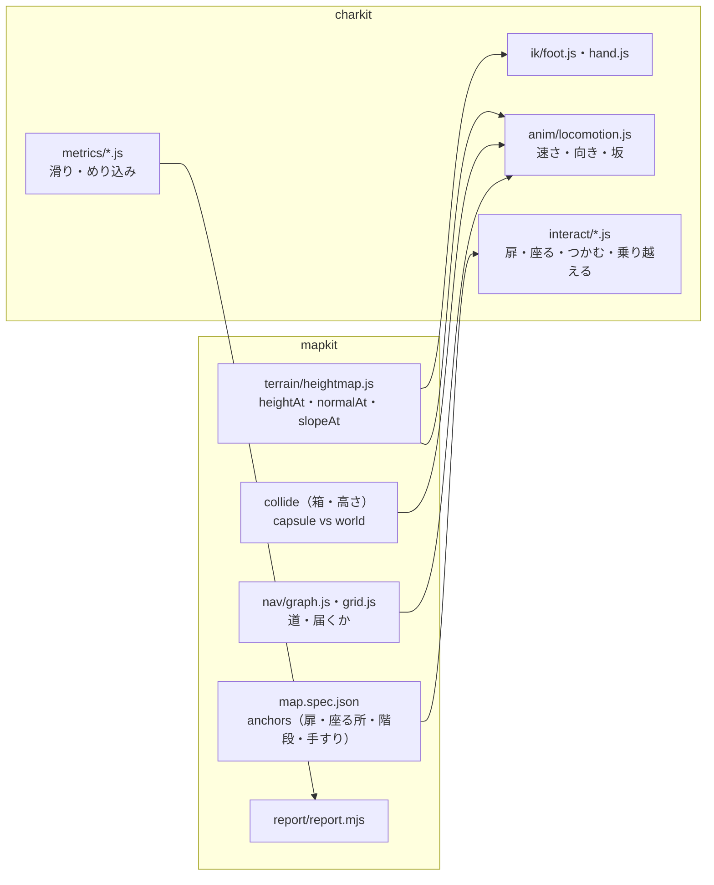

# 05 3D マップ基盤（wakaba-mapkit）との統合設計

mapkit（`docs/wakaba-mapkit/`）は「地形・配置・当たり・道案内・検査」、charkit は「体・動き・顔・陰影」。**同じ規則（単位 m・Y が上・+Z が前・種つきの乱数・メタデータ・ライセンス門・仕事のファイル）**で作り、二重に作らない。
mapkit もまだ**フェーズ0（設計のみ）**で、利用者の答え（Q-A1 画風・Q-A2 方式）待ち。本書の内容は mapkit のフェーズ 2（仮の地形で歩ける）の後に実装する。

---

## 1. 役割の分け方



| 必要な物 | 持ち主 | 受け渡し（関数・データ） |
|---|---|---|
| 地面の高さ・法線・傾き | mapkit `terrain/heightmap.js` | `ground.heightAt(x, z)`・`ground.normalAt(x, z)`・`ground.raycastDown(x, y, z, maxDist)`（建物の床・階段も含む「地面の問い合わせ」を 1 つの口に） |
| 体の当たり | mapkit の当たり（今の `collide.js` は XZ の円 vs 箱） | charkit から**カプセル（半径・高さ）**を渡す。地面の高さに沿って y を決めるのは charkit の移動 |
| 歩ける所・道 | mapkit `nav` | 敵・相棒の移動（今の `navPath` を高さ対応に） |
| 扉・座る所・階段・手すり・乗り越えられる段 | **map.spec.json の `anchors`**（§2 で足す） | charkit の `interact` が読む |
| 検査のレポート | mapkit `report.mjs`（`07` §7 の形） | charkit の数値（足の滑りなど）を `auto.character` の欄に入れる（§4） |

---

## 2. 地図仕様（map.spec.json）への追加：`anchors`

mapkit `07` §5.2 の仕様に**欄を 1 つ足す**（既存の欄は変えない）。建物の部品（`bld.*`）が持つ印から自動で作る物と、手で置く物がある。

```json
{
  "anchors": [
    { "id": "h1.door", "type": "door", "at": [118.4, 0, 108.2], "rotY": 15, "width": 1.8, "height": 1.8, "kind": "sliding", "handle": { "side": "right", "height": 0.95 }, "approach": 0.6, "auto": true },
    { "id": "h1.engawa", "type": "seat", "at": [121.0, 0, 110.5], "rotY": 195, "seatHeight": 0.45, "depth": 0.9, "kind": "edge", "auto": true },
    { "id": "shrine.steps", "type": "stairs", "from": [158.0, 0, 166.0], "to": [160.0, 0.9, 170.0], "steps": 5, "stepHeight": 0.18, "width": 1.6, "rail": false },
    { "id": "h3.wall_low", "type": "vault", "at": [109.0, 0, 133.0], "rotY": 40, "height": 0.8, "depth": 0.3 },
    { "id": "h1.shelf_item", "type": "grab", "at": [119.2, 1.1, 111.0], "hand": "right", "kind": "pickup_small" }
  ]
}
```

| type | 使う動き | 合わせ方（`14` §4.8） |
|---|---|---|
| door | 近づく → 取っ手に手を伸ばす → 開ける（引き戸／開き戸）→ 通る | 立つ位置（`approach`）へ歩いて合わせ（移動の終わりを合わせる＝モーション・ワーピングの代わり）、手は IK で取っ手へ |
| seat | 座る・立つ | 尻の位置を `seatHeight` に合わせて座るクリップの高さをずらす |
| stairs | 階段の上り下り | 一段ごとの足の置き場所を計算（段の中央）＋足の IK。歩幅を段の奥行に合わせる |
| vault | 低い壁を乗り越える | 手を置く位置を IK、高さで 2 種のクリップを選ぶ |
| grab | 拾う・つかむ | 手の IK＋腰の高さ（しゃがむ量）を目標の高さで選ぶ |

- `auto: true` は建物の部品の印（例：glTF の空のノード `ANC_door`）から mapkit の組み立てが作った物。mapkit `07` §4.4 の部品の規格に「**`ANC_` の頭の空ノードで印を置く**」を足す提案（mapkit の資料は変えず、mapkit のフェーズ 1 で反映を相談）。
- **境界侵食の今の扉**（`shinshoku/` の扉）は別の作業が直している最中のため、本書では触らない。charkit の扉の動きは、境界侵食の扉の仕組みが落ち着いた後に `anchors` の形へ合わせる。

---

## 3. 地形への合わせ方（足の IK だけにしない）

| 層 | 中身 | 値の例（`06` §6 の性格の値で変える） |
|---|---|---|
| 1. 体の高さ | 両足の下の地面の高さの低い方に腰を下ろす（坂・段で体が浮かない） | 腰の下げ幅の上限 0.25m |
| 2. 体の傾き | 坂の上りは前へ・下りは後ろへ傾ける（坂の角度 × 係数） | 上り 0.35・下り 0.2（係数） |
| 3. 歩幅と速さ | 坂で歩幅を縮め・足の運びを遅く（上り 20° で 0.8 倍など） | 坂の角度ごとの表 |
| 4. 足の IK | 足を地面の高さに合わせ、足の裏を法線に沿わせる（つま先・かかとの 2 点） | 足首の傾きの上限 25° |
| 5. クリップの選択 | 急な坂（25° 以上）・階段は専用のクリップ | – |
| 6. 手 | 壁・手すりに手を添える（近い時だけ・任意） | 手を伸ばす距離 0.6m |

- 足の IK は**着いている間だけ**強く効かせる（クリップの「着地の印」or 足の高さと速さで判定）。浮いている足は弱く（空中で足が引っ張られないように）。
- 地面の問い合わせは 1 フレームに 1 体あたり 2〜4 回（足ごと・前後）。mapkit の高さマップは配列の読み出しなので軽い。建物の床・階段は当たりの箱から高さを返す。

---

## 4. 検証マップでの試験（mapkit の「山の廃村」で）
mapkit `07` §7 のレポートに `auto.character` を足す：

```json
{
  "auto": {
    "character": {
      "char": "dannoura",
      "route": "start→h1.door→h1.engawa→shrine.steps→start",
      "footSlide": { "flatMeanCmS": 1.2, "slopeMeanCmS": 2.8, "stairsMeanCmS": 3.1, "p95CmS": 4.6, "pass": true },
      "footPenetrationCm": { "max": 1.5, "pass": true },
      "floatFootCm": { "max": 1.8, "pass": true },
      "interactions": { "h1.door": "pass", "h1.engawa": "pass", "shrine.steps": "pass" },
      "transitionsPopDeg": { "max": 9.5, "pass": true },
      "perf": { "device": "swiftshader", "fps": null, "note": "実機で測る" }
    }
  }
}
```
- 数値の合格の線は `13`。`device: swiftshader` の時の fps は参考にしない（mapkit と同じ）。

## 5. 順番（mapkit と charkit の依存）
| mapkit | charkit | 依存 |
|---|---|---|
| フェーズ 1（スキーマ・ライセンス門） | フェーズ 1（キャラクター・モーションのスキーマ） | **同じ時期に**。目録の形を共通にする（`07`） |
| フェーズ 2（仮の地形で歩ける） | フェーズ 2（クリップの再生・検査） | charkit の地形の試験は mapkit 2 の後。それまでは**平らな地面＋手で作った坂・階段の試験場**（`tools/charkit/testyard.html`）で進める |
| フェーズ 3 以降 | フェーズ 6（地形・扉・座る） | mapkit の `anchors` が必要 |

**優先の質問（Q-P1）**：マップ基盤とキャラクター基盤の**どちらを先に進めるか**。並行も可能だが、利用者の手作業（Blender・確認）の時間が足りないなら、**キャラクターは「1 体を読み込んで平らな試験場で動かす」まで、マップは「仮の地形で歩ける」まで**を先に揃えるのが安全（`12`）。
