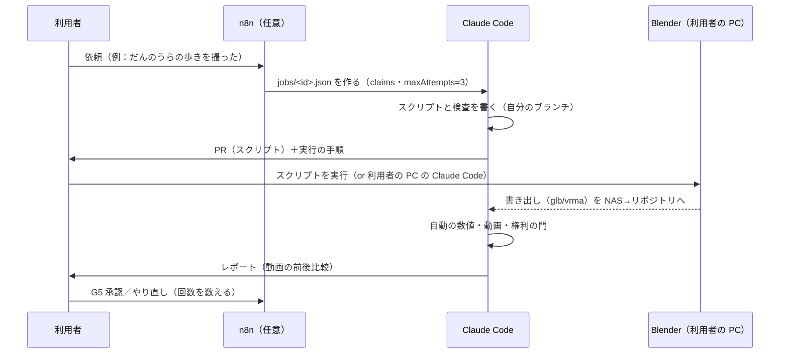

# 08 自動化可能工程一覧（と AI チーム・n8n の役割）

記号：**〔C〕クラウドの AI だけでできる**（このコンテナ・GitHub）／**〔S〕利用者の PC で動かすスクリプト**（Blender の bpy・ffmpeg・Python・Node。AI が書き、利用者が実行 or 利用者の PC の Claude Code が実行）／**〔M〕人の手作業・判断**。
「できる」は**今のこの環境での見込み**。GPU・利用者の PC が要る物はクラウドでは試験できない。

---

## 1. 工程ごとの一覧

| # | 工程 | 区分 | 自動化の中身 | 人が残る所 |
|---|---|---|---|---|
| 1 | 人物の設定 → 性格の値の案 | C | STORY_BIBLE から `personality` の案と理由（`basis`）を書く | 値の承認 |
| 2 | デザインの基準表のチェック表 | C | 項目・寸法・男性の特徴の確認の表を作る | 絵を描く・選ぶ（M） |
| 3 | デザイン画の生成 | M（わかばシステム／画像生成） | 依頼文の下書き（C） | 生成・選択・承認（G1）。**AI の連続の作り直しは 3 回まで** |
| 4 | VRoid での素体づくり | M | 体型の数値の表（C） | 全部 |
| 5 | 画像 → 3D AI の下書き（任意） | S | 実行スクリプト（GPU の量が足りれば） | 結果の判断 |
| 6 | Blender の検査（縮尺・原点・穴・材質名・三角形・骨の数） | S | `validate_char.py`（bpy・ヘッドレス） | 直す作業 |
| 7 | 顔の法線の転写・SDF の顔影の地図の生成 | S | `face_normals.py`・`face_sdf.py` | 見た目の判断 |
| 8 | 標準骨格への名前の付け替え・`ext_` の骨の確認 | S | `rename_bones.py`（対応表から） | 足りない骨を足す |
| 9 | 変形の試験のポーズの撮影 | S | `deform_test.py`（決まったポーズ集→画像） | 重みの修正（M） |
| 10 | 補正の形の対応表（JSON） | C／S | 形の名前から JSON を作る | 形を作る（M） |
| 11 | VRM／glb の書き出し | S | `export_vrm.py`（VRM アドオンの書き出しを固定の設定で。**アドオンの Python API で自動化できるかは未確認**） | 設定の確認 |
| 12 | 取り込みの検査（glTF の検証・骨・表情・三角形・テクスチャ） | **C** | `validate_char.mjs`（gltf-validator・自作の検査）。ファイルがリポジトリに来れば実行できる | – |
| 13 | 陰影の値（JSON）の初期案 | C | 三面図の色から材質ごとの色の案 | 見た目の調整（M） |
| 14 | 陰影の比較の撮影（4 場面） | C（ソフト描画）／S（実機） | `lookdev.html`＋Playwright | 判断（G3） |
| 15 | 撮影の計画（ショットリスト） | C | 必要なモーションの一覧から作る | 演じる（M） |
| 16 | 動画の前処理（切り出し・顔のぼかし・音を消す） | S | ffmpeg のスクリプト | 区間の指定 |
| 17 | 動画 → 骨（MediaPipe／FreeMoCap） | S | 実行スクリプト | – |
| 18 | リターゲット（標準骨格へ） | S | `retarget.py`（Blender） | 結果の確認 |
| 19 | 足の接地の印・滑りの消去・ふるえの減衰・ループの継ぎ目 | S | `cleanup_motion.py` | 手直し（M） |
| 20 | 根の動き・速さ・歩幅の計測 → メタデータ | C | `library.mjs`（glb/vrma から計算） | – |
| 21 | 戦闘のこまの検査（`combatRef`） | **C** | 07 §5 | 伸縮の倍率が範囲外の時の作り直し（M） |
| 22 | 権利の門（ライセンス・同意・模型の制限） | **C**（判定） | 07 §4 | **権利の確認（verifiedBy・同意の記録）は人** |
| 23 | 実行時の仕組み（混ぜる係・IK・視線・口・揺れ・陰影） | **C** | コードと試験 | 手触りの判断 |
| 24 | 自動の数値（滑り・めり込み・継ぎ目・口のずれ・描画呼び出し） | **C** | `metrics.mjs`（こま送りで骨の位置を記録して計算） | – |
| 25 | 動画での確認（前後の並べ） | C（ソフト描画で撮れる）／S（実機） | `capture.mjs`＋ffmpeg | 見て点数（`quality.human`・M） |
| 26 | 実機の fps・GPU のメモリ | S | `?perf=1`＋記録のスクリプト | 結果を貼る |
| 27 | 目録への登録・PR | C | `library.mjs`・GitHub | マージ（G6） |
| 28 | UE の取り込み・Motion Matching の試し | M（S は一部：UE の Python） | FBX の書き出しの固定 | UE の操作 |

まとめ：**クラウドだけで完結するのは 12・20〜25・27**（ファイルが届けば）。Blender の作業（6〜11・16〜19）は**スクリプトを AI が書き、利用者の PC で実行**。デザイン・モデル・撮影・見た目と権利の判断は**人**。

---

## 2. AI チームの役割

| 担当 | 役割 | 書き込み | してはいけない |
|---|---|---|---|
| **利用者** | 方針・デザイン・承認（G1〜G6）・権利の確認・撮影・実機の確認 | 全部 | – |
| **Claude（リード・チャット）** | 設計・仕様・依頼の分解・判断の材料の整理 | 文書（PR 経由） | 承認の代行 |
| **Claude Code（クラウド）** | 実装・試験・Blender のスクリプトを書く・検査・動画の撮影（ソフト描画）・PR | 自分の仕事のブランチだけ | main への直接の書き込み・素材の購入・権利の判断 |
| **Claude Code（利用者の PC）** | Blender・ffmpeg のスクリプトの実行・実機の計測・（Blender MCP をつなぐなら）Blender の操作 | 自分の仕事のブランチ・NAS の作業フォルダ | 原本の上書き（必ず版を分ける） |
| **Codex** | **レビュー**（コメント）。決められた小さな仕事だけ別のブランチで実装 | 割り当てられた仕事のブランチだけ | 他の AI と同じファイルを同時に編集 |
| **ChatGPT** | アイデア・デザインの言葉の案・画像生成の依頼文の相談 | 書き込みなし（人が貼る） | 正史の決定 |
| **Grok** | 調べものの照合（版・規約の二重確認）・アイデア | 書き込みなし | 同上 |
| **Blender** | モデル・骨・掃除・書き出しの実行（スクリプトで） | NAS の作業フォルダ | – |
| **UE** | 試し（Motion Matching・Chaos Cloth）・動きの掃除の道具 | NAS の UE のプロジェクト | – |
| **n8n** | 仕事の受付・順番待ち・承認の通知・夜間の重い処理の順番 | 仕事のファイルの状態だけ | 承認の代行・見た目や権利の判断 |

### 2.1 仕事の制御（mapkit `07` §8 をそのまま使い、2 つ足す）
- 仕事のファイル `jobs/<id>.json`：`{ id, title, assignee, branch, claims, needs, status, approvals }`（mapkit と同じ）。
- **同時に書かない**：`claims`（例 `charkit/anim/**`・`shinshoku/assets/characters/dannoura*`）が他の取りかかり中の仕事と重なったら取れない。
- **足す 1：やり直しの上限**：`attempts`（試した回数）と `maxAttempts`（既定 **3**）。生成（画像・3D・モーションの AI 変換）の仕事は、**前回と入力（依頼文・設定・元の動画の区間）が変わっていないと再実行しない**（`inputHash` を比べる）。上限に達したら `status: blocked` で人へ。
- **足す 2：重い仕事の 1 本化**：`needs.gpu: true` の仕事は利用者の PC で**1 つずつ**（VRAM 8GB を取り合わない）。夜間の順番は n8n（任意）。

---

## 3. 自動化しないこと（はっきり決める）
- 見た目の良し悪し・表情の自然さ・性格に合っているか（**人の目**。AI は数値と指摘まで）
- ライセンス・演者の同意の確認（`verifiedBy`・`performerConsent` は人）
- 購入・有料の契約・外部サービスへの動画のアップロード（顔・個人の情報が出るため、**利用者が一回ずつ判断**）
- 正史（設定）の変更（だんのうらの性別・性格・娘の扱いなど）
