# 12 段階別実装計画（フェーズ 0〜8）

**2026-10-17：方式 A・B・C 全部採用**（mapkit `10`）。下のフェーズ 2〜7 は**A 線（ブラウザ版・クラウド）**のまま進める。B 線（UE5 の PC 版）のキャラクターは「1 体目のモデル（フェーズ 4）ができた後に、同じ正本から FBX を書き出して UE5 に入れる」＝フェーズ **C-ch**（下の表の後）。フェーズ 8 の「UE の試し」は「UE5 版の品質の比較」に読み替える。
各フェーズは**利用者の承認の後**に始める。受け入れ条件は**試験で確かめられる形**にした（数値の線は `13`）。〔C〕〔S〕〔M〕は `08` と同じ。
mapkit のフェーズ（`docs/wakaba-mapkit/06`）との関係を右の列に書く。

```mermaid
gantt
  dateFormat  X
  axisFormat  %s
  section charkit
  P0 調査と設計            :done, p0, 0, 1
  P1 データの土台（済）      :done, p1, 1, 2
  P2 クリップの再生と計測    :p2, 2, 4
  P3 アニメ調シェーダー v2   :p3, 3, 5
  P4 1 体目のモデル（利用者） :p4, 2, 7
  P5 モーションの流れ        :p5, 5, 8
  P6 地形・ふれる動き        :p6, 7, 9
  P7 顔・揺れ・戦闘          :p7, 7, 10
  P8 品質の評価・UE の試し・展開 :p8, 10, 12
  section mapkit（参考）
  M1 スキーマ（済）          :done, m1, 1, 2
  M2 仮の地形で歩ける        :m2, 2, 4
```

（横軸は順番の目安で、週ではない）

| フェーズ | 中身 | 担当 | 受け入れ条件 | mapkit との関係 |
|---|---|---|---|---|
| **0 調査と設計**（今回） | 本資料 16 本・調査スクリプト | C | 資料がそろう・JSON がすべて読める（node で確認済み）・利用者が `15` の★に答える | mapkit P0 と同じ時期 |
| **1 データの土台**（**済：2026-10-17**） | `charkit/schema/`（キャラクター・モーション）・`charkit/rig/bonemap.js`（今の `bones.js` を移して広げる。元は import し直すだけ）・`chains.json`・`tools/charkit/validate_char.mjs`・権利の門の規則（mapkit のライセンス門へ足す）・試験用の glTF（指・目・`ext_`・短いクリップ入り）を生成する道具 | C | `node tests/run.mjs` が通る／`bones.js` の今の試験が変わらず通る／試験用 glTF が gltf-validator でエラー 0／スキーマの例（`06`・`07`）が検査を通る／止めるべき例（同意なし・SMPL・Mixamo を Web）が門で止まる | **mapkit P1 と一緒に**（目録のスキーマ v1.1） |
| **2 クリップの再生と計測** | `vrm.js` の `animations:"clips"` を本当に使う・VRMA の読み込み（three-vrm-animation を版固定で同梱）・混ぜる係（1D／2D の混ぜ・足の位相を合わせた切り替え）・手続きの今の歩きを予備に・**こま送りの撮影 `capture.mjs`＋ffmpeg**・`metrics.mjs`（足の滑り・継ぎ目・めり込み）・`?perf=1` にキャラクターの時間 | C（＋S：VRoid の仮の素体を 1 体書き出す） | 試験用 glTF のクリップが再生される／**VRoid の仮の素体で：表情・瞬き・視線・SpringBone が動く**（ソフト描画の動画で確認）／仮のクリップで足の滑りの数値が出る／**境界侵食の既存の試験・通しプレイが変わらず通る**（manifest が `file: null` の時は今と全く同じ）／実機で 1 回 fps を測る | – |
| **3 アニメ調シェーダー v2** | `charkit/shader/`：材質の種類ごとの段の陰影・SDF の顔影・髪のハイライト・目の奥行き・画面での太さが一定の輪郭線・光に合わせたリム・環境に合わせる量・夜の明るさの下限。`lookdev.html`（4 場面）。MToon からの値の変換 | C＋M（見た目） | 4 場面の撮影がそろう／コード製のキャラクターにも当てられる（今の見た目を壊さない設定がある）／描画呼び出しが `10` の段の範囲／G3（利用者が見て承認） | – |
| **4 1 体目のモデル** | デザインの基準表（G1）→ VRoid → Blender（掃除・骨・`ext_`・指・補正の形・重み）→ VRM 書き出し（G2） | **M**＋S（検査・変形の試験のスクリプト） | `validate_char` が通る（三角形・材質・骨・表情・テクスチャ）／変形の試験のポーズ集で破綻なし（人が見る）／manifest に入れて境界侵食が動く | – |
| **5 モーションの流れ** | Blender のスクリプト（リターゲット・掃除・書き出し）・撮影の手順・権利の記録・目録への登録・最初の 15 本（`11` §5） | S＋M＋C（検査・登録） | 15 本が目録に入る（権利の門を通る）／足の滑りなどが `13` の線を満たす／人の点数（`quality.human`）が付く | 目録は mapkit と共通 |
| **6 地形・ふれる動き** | 試験場（坂・階段・段差・扉・腰かけ）→ 山の廃村（mapkit）。腰の高さ・傾き・歩幅・足と手の IK・`anchors` の読み取り・扉・座る・拾う・乗り越え | C＋M | 試験場と山の廃村で `05` §4 のレポートが通る／扉・座るで手・尻の位置のずれが線以内 | **mapkit P2（仮の地形）の後** |
| **7 顔・揺れ・戦闘** | 文字 → 母音の口・表情の重みの曲線・会話の手（性格の値）・揺れ物の行き過ぎの上限と体の当たり・戦闘のクリップ（手付け中心）とこまの検査・区間ごとの伸縮・根の動きの距離合わせ | C＋M | 口のずれ・めり込み・行き過ぎ・戦闘のこまの一致・入力の遅れが `13` の線／**戦闘の手触りが今より悪くならない**（今の通しプレイの戦闘の試験が通る） | – |
| **8 品質の評価・UE の試し・展開** | 前後比較の動画のレポートの自動化・実機の計測の記録・（任意）UE で Motion Matching と Chaos Cloth の比較・白い姿／相棒へ広げる手順書 | C＋S＋M | 1 体目の全機能（`11` §2 の 1〜12）が通る／2 体目を作る時に**基盤のコードを変えずに**設定とファイルだけで足せる（白い姿で確認）／UE の試しの結論（方式 A のまま or C）を利用者が決める | mapkit の方式の決定（Q-A2） |

## フェーズ 1 の結果（2026-10-17）
| 受け入れ条件 | 結果 |
|---|---|
| `node tests/run.mjs` が通る | ✅ 45/45（新しい試験：`tests/wakaba-charkit-schema・bonemap・gate.test.mjs`、mapkit の 2 本） |
| `bones.js` の今の試験が変わらず通る | ✅ `shinshoku-p3-story.test.mjs` はそのまま通る。`bones.js` は `charkit/rig/bonemap.js` の再輸出だけになり、2 引数の `matchBones` は移す前の実装の写しと 11 通りの骨の名前で突き合わせて同じ |
| 試験用 glTF が gltf-validator でエラー 0 | ✅ gltf-validator 2.0.0-dev.3.10（npm・Apache-2.0）で エラー 0・警告 0・情報 0（作業用のフォルダに入れて確認。リポジトリには入れていない。試験は入っている時だけ使い、無ければ飛ばす） |
| スキーマの例（`06`・`07`）が検査を通る | ✅ だんのうらの設定（男性・体の寸法の欄あり）・歩き・刀の弱・撮影の元 |
| 止めるべき例が門で止まる | ✅ 同意なし・他人の映像・SMPL・研究用 AI・Mixamo を Web・人の点数なし（mapkit の license 不明・商用不可も） |
| 戦闘のこまの照合 | ✅ 刀の弱 1 段目の例・試験用 glTF のクリップが `COMBAT.katana.light[0]`（6・4・14）と一致。2 段目はずれて伸縮で合わせられる・強攻撃は作り直しの印 |
| 境界侵食の動きが変わらない | ✅ manifest は ver 2・`file: null` のまま（`config` は入れていない）。`loadCharacter` は今と同じく null。試験用 glTF は境界侵食の `vrm.js` の `loadGLTF` で読め（17 本・クリップ 4 本）、通しプレイの一部（`--only ch5models`）はページエラー 0 |

まだの事（フェーズ 2 以降）：`charkit/runtime/load.js` への読み込みの移動・クリップの再生（`animations:"clips"`）・VRoid の仮の素体での表情・SpringBone の確認・`capture.mjs`／`metrics.mjs`。だんのうらの設定は**値が仮**で、`license` は利用者の確認（Q-L1・`verifiedBy`）まで門で止まる。

## フェーズ 2〜3・7 の一部の結果（2026-10-17・境界侵食のキャラクターの品質「境界侵食を良くして／キャラクターのクオリティをあげて」）
方式は **(a) コードで組むキャラクター（SkinBody）の作り直し**を選んだ（Blender の台本での新しいモデルより、今の 1 体＝描画 3 回・武器の骨・崩れの効果・白髪形態の差し替えをそのまま使え、確かめられる範囲で一番上がると判断）。VRoid／Blender の 1 体目（フェーズ 4）は利用者の作業のまま。

| 項目 | 入れた物 | 結果 |
|---|---|---|
| アニメ調シェーダー v2（フェーズ 3） | `charkit/shader/toon2.js`：材質の種類ごとの段の陰影（頂点の属性 `mcls`・最大 12 種）・SDF 風の顔影（頭の骨の向きと光の水平の角度から影の境目を出す。顔の網の法線は使わない）・あごの影・髪の天使の輪（Kajiya-Kay の異方性を段に）・金属の段の反射・場面の光に合わせたリム（逆光で強い）・夜の明るさの下限・環境光の色に寄せる量・霧の効き・柄（しま・格子をシェーダーで）・画面でほぼ一定の太さの輪郭線（距離の倍率）・種類ごとの太さと色線。値は `character.json` の `shader`（スキーマに `kind`・`pattern`・`minLuma`・`lineW`・`lineTint` を足した） | ✅ 試験（three の部品の差し替え・種類の表）。4 場面（昼・夜・逆光・屋内）の撮影は `tools/shinshoku_viewer.html?light=…`（lookdev の代わり）。**G3（利用者の承認）はまだ** |
| 前の見た目に戻す | `?charShader=1`（シェーダー）・`?charModel=1`（モデル） | ✅ |
| 揺れ物（フェーズ 7） | `charkit/motion/spring.js`（VRM の SpringBone と同じ考え：慣性・ばね・重力・球とカプセルの当たり・行き過ぎの上限・固定の刻み 60Hz／スマホ 30Hz・瞬間移動と急な向き替えで休みへ戻す） | ✅ 発散なし（dt 1/144〜0.1）・ふつうの動きで当たりの深さ 5mm 超 ≤1%・最大 ≤2cm・止まってから 1.2 秒以内に落ち着く |
| 顔（フェーズ 7） | `charkit/face/lipsync.js`（かな → 母音の拍・漢字は 2 拍・字幕の時間に並べる）・`charkit/face/driver.js`（瞬き・表情・口・視線。コード製の顔と VRM の両方のつなぎ） | ✅ 口の形が 0.5 を超える時刻のずれ ±40ms 以内・瞬き 1 分の回数と長さ（100〜200ms） |
| 足の滑り（フェーズ 2 の計測・6 の一部） | `charkit/anim/metrics.js`（13 §1.1 の式）・境界侵食の v2 の歩き／走りを足の IK に（`shinshoku/actor/anim8.js`） | ✅ 平らな地面で平均 0.3〜0.7cm/s（前の手続きの歩きは 2.2m/s 以上で「着いている」こまが 1 つも無い＝30cm/s を超えて滑る） |
| 戦闘のこま | 攻撃の姿勢は変えていない | ✅ 刀の弱 3 段・強の振りが startup〜startup＋active に入る（試験） |

まだの事：VRoid の仮の素体での表情・SpringBone（VRM の SpringBone は今は three-vrm の物）・`capture.mjs`（こま送りの動画）・混ぜる係（クリップの再生）・SDF の顔影の画像（今は式で作る）・補正の形（モーフ。今は補助の骨で代わり）・実機の fps。

## フェーズ C-ch：同じキャラクターを UE5 版へ（B 線・利用者の PC）
| 中身 | 担当 | 受け入れ条件 |
|---|---|---|
| 骨の名前の付け替えの表と試験（**済：2026-10-17**：`charkit/rig/rename.js`・`tools/blender/bonemap_vrm_to_ue5.json`）／手順書 `tools/blender/vrm_to_fbx.md` | C | ✅ `tests/wakaba-charkit-rename.test.mjs` |
| フェーズ 4 の 1 体目を、正本の写しから FBX（または VRM4U）で UE5 へ・IK Retargeter でマネキンの歩き・走りを写す | S＋M | UE で身長が cm で正しい・腕を上げたポーズが破綻しない（写真）・歩きの足の滑りを `13` の線で比べる（UE から書き出した骨の動きで） |
| UE5 版の陰影（トゥーンを UE の材質で）・揺れ物（Chaos Cloth など） | M（＋C：値の JSON） | 利用者が見て承認 |

## 進め方の約束
- **1 フェーズ＝1 つ以上の PR**。作業は自分のブランチ（`08` §2.1）。他の AI が触っているファイル（今は `shinshoku/` の扉の修正）に重ねない。
- 既存の境界侵食の動き・試験を**壊さない**：新しい仕組みは manifest の設定がある時だけ働く（`file: null`・`config` なしなら今と同じ）。
- 量産しない：**1 体目が機能 1〜12 を満たすまで 2 体目に進まない**。
- 実機の確認が要る受け入れ条件は、利用者が測った値を PR に貼ってもらう（AI は「通った」と書かない）。
