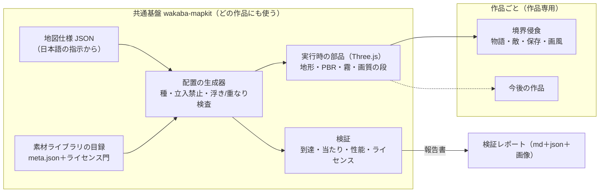
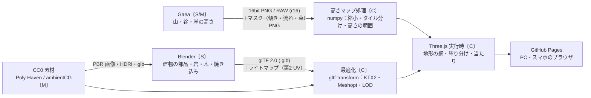
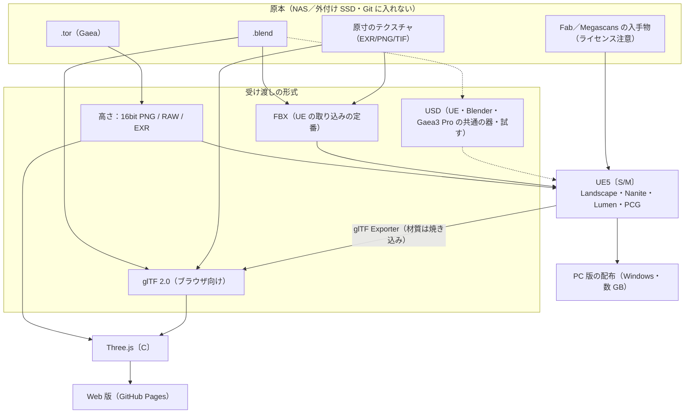
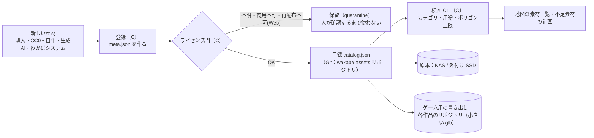
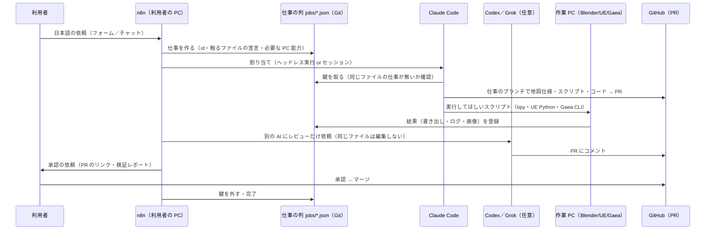
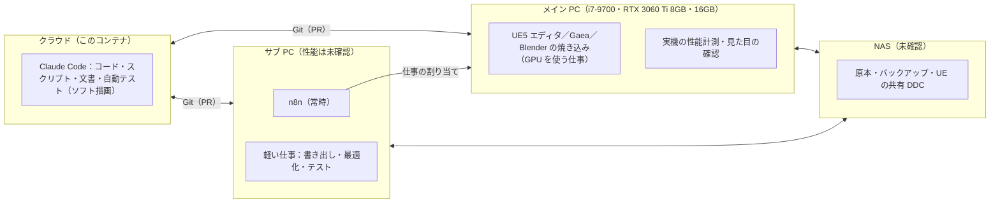

# 05 システム統合構成図

図は Mermaid（GitHub の画面でそのまま図になる）。点線は「任意・後で」。名前の後ろの〔C〕〔S〕〔M〕は `03` と同じ（クラウドの Claude／利用者の PC でスクリプト実行／手作業）。

## 1. 全体（共通基盤と作品の分け方）

## 2. 地形・素材のデータの流れ（案 A：ブラウザの Three.js を本番にする）

## 3. 案 C（両方）：UE5 は高品質の PC 版、Three.js はブラウザ版。素材ライブラリは共通

注意：FAB→UE の線はあるが、FAB→glTF（Web）の線は**引いていない**（再配布の扱いが未確認のため。`04` §3）。

## 4. 素材ライブラリ（目録と置き場所）

## 5. AI チームと n8n の仕事の流れ

## 6. PC の役割分担（案）

- 割り当ての規則（案）：仕事に `needs: { gpu: true, vramGB: 8, ramGB: 16, os: "windows", apps: ["blender>=4.5"] }` を書き、PC の能力表（`tools/survey_local.ps1` の JSON）と照らす。GPU の仕事はメイン PC へ、同時に 2 つの GPU の仕事を入れない（VRAM 8GB のため）。
- サブ PC・NAS の有無と性能は**未確認**（`09`）。無ければメイン PC 1 台で、n8n は軽いので同居させる。
