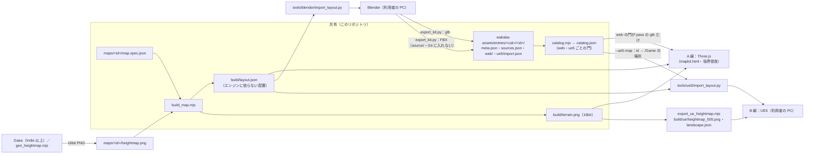

# 10 方式 C：ブラウザ版を続け、UE5 の高性能 PC 版を足す（素材置き場は 1 つ）

作成：2026-10-17／ブランチ `claude/exciting-bardeen-oilbot`／作成：Claude Code（クラウド）
**利用者の決定（Q-A2・2026-10-17）**：「A：今のブラウザ版（スマホでも遊べる）を続け、UE5・Blender・Gaea は素材作りの道具としてだけ使う／B：高性能 PC 向けに、UE5 で別の版を作る／C：A の版と B の版で、素材置き場を共有する　**全て採用**」。
あわせて答えをもらった物：**Q-A1 画風＝「A 案で写実の試験マップ」**（写実は `mapkit.html` の試験マップ「山の廃村」だけ・境界侵食はアニメ調のまま）／**Q-L1 収益化＝商用あり**／**Q-B2 素材の置き場所＝このリポジトリ**／**PC＝i7-9700・RTX 3060 Ti 8GB・メモリ 16GB・SSD 512GB（利用者が確認）・Blender は入っている（版は未確認）**。UE5・Gaea が入っているかは未確認（`09` §0 の 3 手順で確かめる）。

---

## 1. 全体（2 本の線と 1 つの置き場）

| 線 | 中身 | どこで作る・試す | 状態 |
|---|---|---|---|
| **A 線：ブラウザ版**（本線） | Three.js・PC とスマホのブラウザ・GitHub Pages。境界侵食（アニメ調）と、写実の試験マップ「山の廃村」（`mapkit.html`） | クラウドの Claude が作って自動で試験できる | 続ける（フェーズ 3 の写実の見た目へ） |
| **B 線：UE5 の高性能 PC 版** | UE5（Landscape・Nanite・Lumen）。同じ地図データ（`layout.json`・高さ）と同じ素材から作る | **利用者の PC だけ**（クラウドには UE が無い・GPU が無い） | 準備（取り込みのスクリプトと手順を置いた・**未検証**） |
| **共有の置き場**（C） | 素材ライブラリ `wakaba-assets/`（このリポジトリ）・地図仕様と配置（`maps/<id>/`）・ライセンス門（配信先 web・ue5 ごと） | 両方の線が読む | 置いた（下の §2） |



- **正本は 1 つ**：地図＝`map.spec.json`（と高さ PNG）、素材＝`meta.json`＋原本（`.blend` など）。Three.js・Blender・UE5 の物は全部**書き出し（生成物）**。
- UE5 で作り込んだ物（例：手で置き直した岩）を Web へ戻す時も、**Blender の正本か地図仕様を直す**（UE のレベルを正本にしない）。UE の Lumen・Nanite の見た目そのものはブラウザへ持っていけない（`08` §6）。
- 境界侵食（アニメ調・Three.js）は今のまま。写実は試験マップ（`mapkit.html?map=haison`）の中だけ（Q-A1）。

## 2. 共有素材ライブラリ（置き場所＝このリポジトリ）

```
wakaba-assets/
  catalog.json                         目録（生成物：node tools/mapkit/catalog.mjs。手で書かない）
  entries/<category>/<id>/             1 素材＝1 フォルダ（id は meta.json の id と同じ）
    meta.json                          素材メタデータ v1.1（07 §3）＝ライセンス門の対象・正本
    sources.json                       原本の指し先（wakaba-asset-sources/1）：場所・sha256・大きさ・道具の版
    source/                            原本の実物（.blend・.fbx・.usd・原寸テクスチャ）＝ .gitignore 済み。各自の PC・NAS から置く
    web/                               ブラウザ版の書き出し（.glb・.ktx2・.png・.jpg・.webp）＝公開の Web の門が pass の物だけ
    ue5/import.json                    UE5 の取り込みの設定（wakaba-ue5-import/1）：/Game の場所・原点・Nanite・当たり
```
- スキーマ：`mapkit/schema/asset-meta.schema.json`（v1.1・変更なし）・`asset-sources.schema.json`・`ue5-import.schema.json`（新）。検査：`mapkit/assets/library.js`（純粋）＋`tools/mapkit/catalog.mjs`（CLI）。
- **重い原本は Git に入れない**：`sources.json` に「どこにあるか（`source/…`＝各自の PC・`nas:/…`・`store:`＝Fab などのアカウント）」と sha256 を書く。別の PC で `source/` に置き直したら `--verify-sources` で同じ物か確かめられる。
  - 50MB を超える原本を Git で持ちたくなったら **Git LFS**（`git lfs track "wakaba-assets/**/source/*.blend"` など）。GitHub の LFS の無料枠（容量・転送量）は**未確認**なので、入れる前に確かめる（`09` S9）。今は LFS を使わない設計（指し先＋sha256）。
- **公開の Web に出せない物**（Fab・Megascans・Mixamo・`redistributeRaw` が yes でない物）を `web/` に置くと `catalog.mjs` が **`WEB_BLOCKED`** で止める（このリポジトリは公開の可能性がある：Q-L3 未回答）。その素材は `source/`（Git の外）と `ue5/import.json` だけで UE5 版に使える。
- 目録の 1 行（`catalog.json` の `entries[]`）：`id・version・category・name・status・tags・dir・license（id・表記）・tech（原点・寸法・三角形）・targets（web・ue5 ごとの pass／block と理由の符号）・sources・web（ファイル・大きさ・テクスチャの辺）・ue5（/Game の場所・原点）`。同じ中身なら同じバイト列（差分が読める）。

### 2.1 配信先ごとの設定とライセンス門（`wakaba.config.json`）
| 配信先 | engine | 公開 | 形式・上限（`settings`） | 門の違い |
|---|---|---|---|---|
| `web`（ブラウザ版・A 線） | threejs | **公開** | glb（Meshopt）・テクスチャは KTX2 を第一（png/jpg/webp も可）・辺 2048 まで（段ごと ultra/high 2048・mid 1024・low 512）・1 ファイル 8MB まで・読み込み合計 PC 60MB／スマホ 15MB | `redistributeRaw: yes` が要る・Mixamo／Fab／Megascans は止める（`KNOWN_NO_WEB`）・`engines` に threejs か any |
| `ue5`（高性能 PC 版・B 線） | unreal | 非公開（パッケージで配る） | FBX・USD・Nanite 可・テクスチャ辺 4096・Landscape の推奨の大きさ | 素のファイルは配らないので `redistributeRaw` を見ない・Fab／Megascans も license が通れば可・`engines` に unreal か any |
- 両方に共通：license 不明・未確認（`verifiedBy` 空）・**商用不可**（作品は商用＝利用者の回答）・AI のモデル名なし・地域の制限・同意なし・SMPL・研究用 AI などは止める（`07` §3.1・charkit `07` §4）。
- 使い方：`node mapkit/assets/license-gate.mjs <file|dir> --target web|ue5|all`（`all`＝順に両方）。目録は `catalog.mjs` が両方の結果を書く。

## 3. Blender（両方の線の「作業台」）
| スクリプト | すること | 試した所 |
|---|---|---|
| `tools/blender/import_layout.py` | `layout.json`＋`terrain.png` から場面を組む：地形の網（16bit をそのまま・`--terrain-step`）・建物の部品（箱・円柱・切妻）・物（**種類＝素材の id ごとに網を共有**：本物の網に替えると全部替わる・`--kit`）・下草の点（Geometry Nodes 用）・目的地と印（空の物）・道（曲線）。コレクションは `Wakaba_<id>/Terrain・Buildings/<建物>・Objects/<層>・Anchors_Goals・Paths`。何度流しても同じ（前の分を消す） | クラウドで bpy 4.2.0（作業用のフォルダの仮の環境・リポジトリには入れていない）：山の廃村で **0.2〜0.4 秒**（地形 66,049 頂点・部品 124・物 687・下草 18,073 点）。glTF に書き出すと**位置・回転（屋根の傾きも）が layout.json と一致**（四元数まで） |
| `tools/blender/export_kit.py` | コレクション `KIT` の物（名前＝素材の id）を、ライブラリへ **glb（Web）＋FBX（UE5）**。原点＝底の中心・scale 1 の決まりを確かめる・`sources.json` に sha256 を書く・`ue5/import.json` の雛形（`/Game/Wakaba/<分類>/SM_<id>`）。license が Web に出せない物は glb も `source/` へ | bpy 4.2.0 で CC0 の岩と Fab の岩の 2 つ：前者は `web/`、後者は `source/` に分かれ、`catalog.mjs` が web:pass・ue5:pass／web:block・ue5:pass を出し、Fab の glb を `web/` に置くと `WEB_BLOCKED` で止まることを確認 |
- 決まり：**1 単位＝1m**（Blender の単位の倍率 1.0）・glTF は +Y 上・FBX は「単位の倍率を適用（FBX_SCALE_UNITS）」で UE では cm・UE の名前は `SM_<id の . を _ に>`。
- 利用者の Blender の版は未確認（`09` S2）。bpy 4.2 で試したが、4.5 LTS／5.x でも使う関数は同じ（`from_pydata`・`export_scene.gltf`・`export_scene.fbx`）。**利用者の PC では未検証**。

## 4. UE5（B 線）への取り込み
1. 地形：`node tools/mapkit/export_ue_heightmap.mjs maps/haison` → `maps/haison/build/ue/heightmap_505.png`（16bit・505×505）・`landscape.json`。**リポジトリに作り済み**（試験が「layout と合っているか」を見る）。
   - 大きさは UE の推奨（127・253・505・1009・2017・4033・8129）から「元の頂点数以上で一番小さい物」（`--size` で変更）。山の廃村（257 頂点・256m）は 505（1 升 約 0.51m）＝区画 4×4・63 quads・2×2 sections。
   - 高さは実際の最小〜最大（10.76〜59.50m）を 0〜65535 に広げる。UE の式：高さ(cm)＝(値−32768)×ScaleZ/128＋Location.Z → **Scale X/Y 50.793651・Z 9.520302・Location (0, 0, 3512.88857)**。元の地形との差は 1cm 未満（試験）。
   - `--points` で物と下草の点を `pcg_points.csv`（UE のデータテーブル・PCG 用。約 1MB なのでリポジトリには置かない）。
2. 物：`tools/ue5/import_layout.py`（Unreal Editor の Python）。部品・物を StaticMeshActor で置き（仮の形は `/Engine/BasicShapes`）、目的地・印は TargetPoint、スタートは PlayerStart。素材の id が目録の `ue5` の表にあれば本物の網（`catalog.mjs --ue5-map`）。**UE の中で一度も動かしていない（未検証）**。手順は `tools/ue5/README.md`。
3. 座標の写し方（`mapkit/core/ue.js`・Python の 2 本と試験で一致を確認）：UE (X, Y, Z)＝layout (x, z, y)×100cm・Yaw＝−rotY・Roll＝tilt・大きさ (幅, 奥行, 高さ)。2 軸の入れ替えで右手系 → 左手系になるので鏡写しにならない。Landscape は画像の列＝X・行＝Y のまま（反転しない）。Blender から FBX で UE に入れた物も同じ位置になる（Blender (x, −z, y) → UE の FBX の取り込みが Y を反転）＝**未検証**（UE の画面で 1 回確かめる：README の「確認 1」）。

## 5. Gaea（地形）：両方の線が同じ高さを使う
- 置き場所：**`maps/<id>/heightmap.png`**（16bit グレー PNG・正方形）。地図仕様の `terrain.source` に `file`・`minY`・`maxY`（PNG の 0 と 65535 が何 m か）を書く。Web（`build_map.mjs`）も UE（`export_ue_heightmap.mjs`）もここから作る。
- Gaea の書き出し（Gaea 2.x・**未検証**：画面の名前は版で違う）：Build の設定で **Format＝PNG・Bit depth＝16 bit**（RAW16・EXR も可：RAW16 は `heightfieldFromRAW16` で読める・EXR は今は読めない）、**Resolution＝1025 か 513**（Web の升目が 256m／1024＝0.25m などの割り切れる数になる）。Gaea の地形の高さ（m）を `maxY−minY` に書く。
  - UE へは `export_ue_heightmap.mjs --size 1009`（1025 から少し縮める）か既定の 2017。
- **ライセンス**：Gaea **Community は非商用のみ・書き出し 1024 まで**（`04` §2）。作品は**商用**（Q-L1 の回答）なので、**Community で作った地形は本番の地図に使えない**（門の `NON_COMMERCIAL`）。本番に使うなら **Gaea Indie（$99・年商 10 万ドル未満）以上**、または今の手続きの地形（`gen_heightmap.mjs`・自作＝商用可）。試しに Community で作るのは可（`--stage dev` の試しだけ・作品に入れない）。
- 高さの素材の meta.json（`category: terrain`・`source.type: self_made`・`license.id: project`・`deps` に `gaea-indie` など）を書くと、門と目録で管理できる。

## 6. 何を確かめたか（クラウド）／未検証
| 項目 | 状態 |
|---|---|
| 配信先ごとの門（Fab・Megascans・Mixamo は web で止まり ue5 で通る・商用不可は両方で止まる）・`--target all` | ✅ 試験（`tests/wakaba-mapkit-bridge.test.mjs`） |
| 1 素材＝1 フォルダの検査・目録の生成（同じ中身→同じバイト列・`--check`・sha256 の突き合わせ・`WEB_BLOCKED` など） | ✅ 試験 |
| `layout.json` のスキーマ＋中身（指紋・重複・範囲・下草の数）・壊した例が落ちる | ✅ 試験（`validate_spec.mjs` でも見られる） |
| UE の Landscape の区画の割り方（Epic の推奨の表）・Scale/Location の式・505 の書き出しの高さの差 < 1cm | ✅ 試験（式は Epic の資料の形。UE の画面では未検証） |
| Blender・UE の Python の座標の式が JS と一致（素の python3 の `--selftest`） | ✅ 試験 |
| Blender で組む・glTF で戻す・ライブラリへ書き出す（bpy 4.2.0・作業用の仮の環境） | ✅ 1 回試した（試験には入れていない：bpy は 500MB あり CI に置かない） |
| 利用者の Blender（版は未確認）で動くか | ⏳ **未検証** |
| UE5 の取り込み（Landscape の手作業・`import_layout.py`・FBX の向きと大きさ） | ⏳ **未検証**（クラウドに UE が無い） |
| Gaea の書き出しの画面の手順 | ⏳ **未検証**（Gaea が入っているかも未確認） |
| フェーズ 3（2026-10-17）：自作の材質 25 組・部品 31 個がライブラリに入り、目録で web・ue5 とも pass（部品は FBX を `source/`・`ue5/import.json` の雛形つき・`tools/blender/kit/build_kit.py`） | ✅ ブラウザ版で使用（`11`）／⏳ UE5 での取り込みは**未検証** |

## 7. 利用者の PC で次にすること（順番）
1. **確かめる（5 分）**：`09` §0 の 3 手順（調査スクリプト、または手で：Epic Games Launcher → Unreal Engine → ライブラリ／スタートメニューか `C:\Program Files\QuadSpinner`／Blender の Help → About）。結果を貼る。
2. **Blender で山の廃村を開く（10 分）**：リポジトリを `git pull` → コマンドプロンプトで
   `"C:\Program Files\Blender Foundation\Blender 4.5\blender.exe" --background --python tools\blender\import_layout.py -- maps\haison\build\layout.json --save haison.blend`
   （Blender の場所・版は各自の物に）→ `haison.blend` を開いて、地形と灰色の家・木の箱が並ぶか見る。表示された `WAKABA_IMPORT …` の行を貼る。
3. **UE5 が入っていれば（30 分〜）**：`tools/ue5/README.md` の「最初の 1 回」。入っていなければ急がない（A 線は UE なしで進む）。メモリ 16GB では UE と Blender・ブラウザを同時に開かない。
4. **素材を 1 つ通す（任意）**：CC0 の岩を 1 つ Blender で整え、`KIT` に入れて `export_kit.py` → `node tools/mapkit/catalog.mjs` → 結果を貼る（`meta.json` の `verifiedBy` は利用者が書く。AI は書かない）。

## 8. まだ決めていないこと
- UE5 の版（入っているか・5.6／5.7／5.8 のどれか）、Gaea の有無とエディション（Community なら本番には使えない）
- このリポジトリは public か private か（Q-L3）：public なら Fab・購入物の原本は `source/`（Git の外）だけ。private でも原本は Git に入れない方針は同じ
- UE5 版の配り方（Steam・itch.io など・署名・更新）と、UE5 版の遊びの部分（Blueprint）を誰が作るか（W1）
- 写実の試験マップの見た目の承認（フェーズ 3 の撮影 6 枚）
