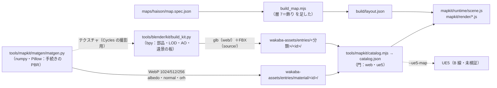

# 11 写実化パイプライン（フェーズ 3・A 線：ブラウザ版の試験マップ「山の廃村」）

作成：2026-10-17／ブランチ `claude/exciting-bardeen-oilbot`／作成：Claude Code（クラウド）
**写実は `mapkit.html?map=haison` の試験マップだけ**（Q-A1）。境界侵食（`shinshoku.html`）はアニメ調のまま（共通の部品は触っていない：`mapkit/render/atmosphere.js` の霧の差し替えは mapkit のページの中だけで効く）。
> **追記（2026-10-18・境界侵食 P16）**：利用者の依頼「木などのモデリングは試験マップと同じ作り方にしてください」により、**植物（街路樹・庭木・公園と社の木・生垣・植え込み・鉢植え・観葉植物・雑草・草）と岩・瓦礫は、境界侵食も試験マップと同じ道具・同じ素材ライブラリ・同じ描き方**になった（§8）。人物はアニメ調のまま・町の建物は P12 の地図帳の PBR のまま。試験マップの見た目と動き（`play_map.mjs` 49/49）は変わっていない。
外の素材サイト（Fab・Megascans・Poly Haven・ambientCG）はクラウドから繋がらないので、**素材は全部このリポジトリの道具で作った自作**（license `own`・商用可・再配布可）。利用者の Blender・Gaea・Megascans の素材は、同じ id のフォルダを置き換えれば差し替わる（§5）。

---

## 1. 全体の流れ
> **地形の正本＝リポジトリの手続きの地形（2026-10-17 決め）**：利用者の PC に **Gaea は入っていない**（`09` §0）。地形は今まで通り `mapkit/terrain/`（`node tools/mapkit/gen_heightmap.mjs maps/haison`：同じ仕様＋種 → 同じ 16bit PNG・自作＝商用可）で作り、ブラウザ版も UE5 版（`export_ue_heightmap.mjs`）も同じ PNG から作る。Gaea は要らない。
> 将来 Gaea を使いたくなったら：作品は商用なので **Gaea Community（無料）は本番に使えない**（非商用のみ・門の `NON_COMMERCIAL`）。本番に使うなら **Indie（$99・年商 10 万ドル未満）以上**の購入が要る（`04`・`10` §5）。差し替え方は §5 の 4。
>
> **Blender の標準＝5.2 LTS**（利用者の PC は 5.2.0 LTS）。部品の道具は bpy 5.2.2 と 4.2.0 の両方で試し、同じ構造の glb になる（`10` §6.1）。



| 段 | 道具 | 出す物 | 時間（クラウド・4 コア） |
|---|---|---|---|
| 材質 | `tools/mapkit/matgen/matgen.py`（`tex.py`＝ノイズ・`defs.py`＝材質の式） | 25 組（§2）。原寸 1024px の PNG は `source/`（Git の外・`sources.json` に sha256） | 全部で約 2.5 分 |
| 部品 | `tools/blender/kit/build_kit.py`（`kitlib.py`＝形の道具・`pieces.py`＝部品の式） | 31 部品（§3）：glb（`web/`）・FBX（`source/`）・`ue5/import.json`・meta | 全部で約 20 秒（木の遠景の板の Cycles の撮影込み） |
| 目録 | `node tools/mapkit/catalog.mjs` | `wakaba-assets/catalog.json`（56 件・web／ue5 とも pass・注意 `UNVERIFIED_GENERATED`） | 1 秒 |
| 配置 | `node tools/mapkit/build_map.mjs maps/haison` | `layout.json`（木 865・岩 39・小物 32・飾り 22・下草 18,073）・レポート | 1.3 秒 |
| 描画 | `mapkit.html?map=haison[&preset=ultra|high|mid|low]` | §4 | 起動 ≈3〜5 秒（ソフト描画） |

### 作り直すコマンド（リポジトリの根で）
```
# 作業用の Python（リポジトリにも OS にも入れない。例：作業フォルダに venv）
python3.13 -m venv <作業フォルダ>/bpyenv && <作業フォルダ>/bpyenv/bin/pip install numpy Pillow "bpy==5.2.*"   # bpy 5.2 は Python 3.13 用（4.2.0 なら Python 3.11）
<作業フォルダ>/bpyenv/bin/python tools/mapkit/matgen/matgen.py                 # 材質（--only <id>・--preview <フォルダ>＝光を当てた見本）
<作業フォルダ>/bpyenv/bin/python tools/blender/kit/build_kit.py                 # 部品（--only <id>・--preview <フォルダ>・--no-fbx）
#   Blender 本体でも同じ：blender --background --python tools/blender/kit/build_kit.py -- --only veg.tree.sugi
#   （Blender 本体の Python には Pillow が無いが、numpy で代わりをする。版と機能の確かめ：… build_kit.py -- --selftest）
node tools/mapkit/catalog.mjs                                                    # 目録
node tools/mapkit/build_map.mjs maps/haison && node tools/mapkit/export_ue_heightmap.mjs maps/haison   # 配置（物の id が変わった時）
python3 -m http.server 8797 --directory . & node tools/mapkit/play_map.mjs <撮影のフォルダ>           # 歩く・撮る・測る
```
- 同じ種・同じ版の numpy／bpy なら同じ画素・同じ網（numpy・Blender の版が違うと丸めで小さな差が出る＝`sources.json` の sha256 は参考）。登録済みの部品は bpy 4.2.0 で作った物。5.2.2 で作り直すと構造は同じで、木の遠景の板の絵だけ少し暗くなる（Cycles の版の違い・`10` §6.1）ので、作り直していない。
- 材質の名前（`mat.*`）を部品の材質の名前にしているので、材質を作り直すと部品は作り直さなくても新しい見た目になる。

## 2. 材質（25 組・自作）
| id | 1 回の繰り返し | Web の大きさ | 中身 |
|---|---|---|---|
| `mat.ground.forest_floor` | 2.0m | 1024 | 黒い土・広葉樹の落ち葉（z バッファで重ねる）・杉の落ち葉・小枝・薄い苔 |
| `mat.ground.moss`・`mat.ground.grass` | 1.5・2.0m | 1024 | 苔のクッション／寝た草の葉と土 |
| `mat.ground.gravel_path`・`mat.ground.dirt_path` | 1.5・2.5m | 1024 | 3 段の大きさの丸い小石／踏み固めた土・ひび・湿り |
| `mat.rock.andesite`・`mat.rock.cliff` | 2.5・6.0m | 1024 | 割れ目・節理・地衣類／うねる地層（崖は三面投影） |
| `mat.wood.cedar`・`mat.wood.planks_silver` | 1.2・2.0m | 512・1024 | 風化した杉材（木目＝u）／銀灰の板・すき間・釘の錆 |
| `mat.wall.tsuchikabe` | 2.0m | 1024 | 土壁：すさ・ひびの網・はがれ（荒壁）・雨だれ・カビ |
| `mat.roof.kawara`・`mat.roof.kawara_moss` | 1.2m | 1024・512 | いぶし瓦（桟瓦の断面・段・地衣類）／谷に苔 |
| `mat.metal.tin_rust`・`mat.metal.iron_rust` | 1.5・0.6m | 512 | 錆びたトタン（波・錆の流れ・赤い塗装の残り）／鋳物の鉄 |
| `mat.floor.tatami`・`mat.paper.shoji`・`mat.fabric.futon` | 1.8・0.9・1.0m | 512 | 朽ちた畳（縁・カビ・破れ）／破れた障子（透過）／藍の絣 |
| `mat.paint.shu`・`mat.stone.granite` | 1.0・1.5m | 512 | はがれた朱塗り／御影石（ごま塩・のみの跡・苔） |
| `mat.bark.sugi`・`mat.bark.broadleaf` | 1.0m | 512 | 杉の縦の繊維／広葉樹の浅い割れ・皮目・地衣類 |
| `mat.foliage.sugi`・`broadleaf`・`fern`・`grass` | 1.0（カード） | 512 | 透過のカード（縁の色のにじみ済み＝mip で黒い縁が出ない） |
| （P16）`mat.foliage.keyaki`・`ichou`・`sakura`・`matsu`・`tsutsuji`・`hedge`・`houseplant`・`weed` | 1.0（カード） | 512 | `defs_veg.py`（`matgen_veg.py`）：ケヤキ（鋸歯の小さな葉・晩秋）・イチョウ（扇形・黄葉）・桜（紅葉）・松（2 本ずつの針の房）・ツツジ（密な小さな葉）・生垣（ほぼ全面の葉＝殻にも貼る）・観葉植物（大きな葉・斑）・雑草（細い葉・エノコログサ・切れ込みの葉） |
| （P16）`mat.bark.sakura`・`mat.bark.matsu`・`mat.ceramic.terracotta` | 1.0・1.0・0.8m | 512 | 桜の樹皮（横の皮目）・松の亀甲の樹皮・素焼きの鉢 |
- 1 組＝`albedo_<辺>.webp`（sRGB・透過は RGBA）・`normal_<辺>.webp`（接空間・OpenGL＝G が上）・`orh_<辺>.webp`（**R＝AO・G＝粗さ・B＝高さ**。金属は使わない）。ORH は 512 まで（1024 は色と法線だけ）。
- 値の目安：色は sRGB で 0.1〜0.6（真っ白・真っ黒にしない）・粗さ 0.75〜0.95（プラスチックに見えない）。
- UV はメートル。描画の側で `repeat = 1/tileM`。

## 3. 部品（31 個・自作）
| 分類 | id | LOD（三角形） | メモ |
|---|---|---|---|
| 木 | `veg.tree.sugi`・`veg.tree.broadleaf` | 1528/158＋遠景の板・1318/304＋板 | カードの葉（法線は樹冠の外向き）・幹の管（根の張り）・遠景の板＝Cycles で 2 方向から撮った絵（glb の中・WebP） |
| 下草 | `veg.grass`・`veg.fern` | 6・48 | 3 枚の十字のカード／8 枚の垂れた葉 |
| 岩 | `rock.boulder` | 3 種×1280/320/76 | 割れた平らな面＋ノイズ。大きさは仮の形と同じ（当たりが変わらない） |
| 小物 | `prop.barrel`・`crate`・`planks`・`debris`・`beam`・`kamado`・`tansu` | 56〜1052 | 仮の形の大きさに合わせた |
| 飾り（新） | `prop.irori`・`futon`・`shelf_fallen`・`door_fallen`・`bicycle`・`well`・`utility_pole`・`sign`・`fence`・`komainu`・`stone_lantern`・`ishigaki` | 88〜1382 | 層 7（§4.3）で置く |
| 建物の部品 | `bld.jp_house.wall_panel`（4 種：ひび／小さな穴／大穴／小舞）・`post`・`roof_ridge`・`window_koshi`・`door_shoji` | 44〜1400 | 配置の箱（当たり）に合わせて伸ばして置く（§4.2） |
| 祠 | `bld.shrine.honden`（流造り風）・`bld.shrine.torii`（明神鳥居） | 980・636 | 配置の箱は隠して部品を置く |
| 木（P16） | `veg.tree.keyaki`・`ichou`・`sakura`・`matsu` | 1546/346・2028/319・1401/318・664/283＋遠景の板 | `pieces_veg.py`（`build_kit_veg.py`）：杉・広葉樹と同じ作り（幹の管・樹冠の殻のカード・外向きの法線・遠景の板＝Cycles で 3 方向）。松は枝先の「雲」の段（`kit.cardDup: 0`＝カードの写しをしない） |
| 低木・生垣・鉢（P16） | `veg.shrub.tsutsuji`（3 種）・`veg.hedge`（1m の区画）・`veg.pot`（2 種）・`veg.planter`・`veg.houseplant`（2 種）・`veg.weed` | 66〜392 | 刈り込んだ殻（`mat.foliage.hedge`）＋外へ出る葉のカード（`mat.foliage.tsutsuji`）。生垣・植え込みの箱は伸ばして使う |
| 瓦礫（P16） | `rock.rubble`（3 種） | 222/66 | 割れたコンクリートの塊＋錆びた鉄筋（`mat.town.concrete`・`mat.metal.iron_rust`） |
- 決まり：1 単位＝1m・原点＝底の中心・前＝Blender の −Y（glTF の +Z）。節の名前＝`LOD<n>`（種類が複数なら `v<k>_LOD<n>`）・`IMP`。頂点の色（COLOR_0）＝レイで焼いた AO（地面 z=0 も隠す物に数える＝接地の暗さ）。接線あり（glTF の接線＝法線の向きの符号を合わせる）。
- 検査：`tests/wakaba-mapkit-phase3.test.mjs`（節の名前・材質の名前が目録にある・AO と接線・当たりとの大きさの差）。gltf-validator（2.0.0-dev.3.10・作業フォルダに入れて実行）でエラー 0。

## 4. 描画（`mapkit/render/`・`mapkit/runtime/scene.js`）
### 4.1 部品と LOD
- `assets.js`：目録の **web の門が pass の物だけ**読む。材質は id ごとに 1 つ（同じ組み合わせは共有＝シェーダーは約 35 個）。テクスチャは段の `texMax` 以下の一番大きい WebP。
- `kit.js`：部品 id×種類×LOD×材質ごとに `InstancedMesh` 1 つ。**カメラが動いた時だけ**物ごとに LOD を選ぶ（`lod.js`：距離・ヒステリシス 8%・視野の外と `cull` より遠い物は描かない・スマホは LOD1 から）。数が 0 の組は描画の呼び出しにならない。
- 起動の時に、隠れている組も 1 回だけ描いてシェーダーを作る（家に入った時に止まらない）。

### 4.2 建物（`buildings.js`）
配置（`layout.buildings[].parts`）は**当たり・床・扉のまま**で、見た目だけを組む：土壁の壁＝約 0.95m の区画ごとに `wall_panel`（傷みで種類を選ぶ）を伸ばして置く・区画の境に柱・上に桁・下に土台・窓（下の段 `lo`）に格子・扉の横に障子（開口は塞がない）と鴨居。床＝畳・板・土間の網、屋根＝細かく割った面を傷みに比例してたわませ（瓦／苔むした瓦／トタン）・裏は板・縁は破風・棟は `roof_ridge` を並べる。祠＝基壇と石段は御影石、本殿・鳥居・灯籠は部品。

### 4.3 配置の層 7「飾り」（`mapkit/pcg/dressing.js`）
散布（層 5・6）の**後ろ**に足すので、前の層（木・岩・下草・小物）は 1 つも変わらない（試験）。家の中（布団・倒れた障子・囲炉裏・倒れた棚：当たりなし＝`col: null`）・家のまわり（倒れた自転車・柵・石垣）・祠（狛犬 1 対）・参道（石灯籠 1 対・立て札）・山道（電柱 5 本＝描画の側で電線を張る）・村（井戸）。置けない物は理由つきで `stats` に残す。仕様の `"dressing": false` で止められる。

### 4.4 地面（`terrain.js`）
6 層（森の床・草・苔・土の道・砂利・崖）を頂点の重み（傾き・高さ・道の距離の場・建物の土台・木の密度・ノイズ）で決め、**層の高さ（orh の B）で混ぜる**（境目が石や葉の形に沿う）。崖は三面投影。テクスチャは配列（`sampler2DArray`）3 枚＝描画 1 回。広い範囲の明るさ・色のゆらぎで繰り返しを隠す。接地の暗さ（木の根元・壁ぎわ・窪み）は頂点の AO。スマホは 4 層・三面投影なし。

### 4.5 光と空気（`atmosphere.js`・`post.js`・`wind.js`・`foliage.js`）
- 空：式で描く（天頂の青紫・地平の霞・日の側の輝き・薄い雲）。**環境光**＝空を PMREM で 1 回焼く。日の光（橙・低い）＋空の光。光の高さは最低 9°（仕様の 4° だと全部が影になる。空の輝きは 4° のまま）。
- **高さの霧**：three.js の霧の部品（ShaderChunk）を差し替え：低い所ほど濃い（`heightFalloff`）・日の方向は暖かい色。
- 影：太陽 1 枚（人のまわり ±R m・段で 2048／1024／512／なし）。トーンマップ ACES・露出 1.3。
- 後処理（ultra・high だけ）：HDR の絵 → ブルーム（弱め・3 段）・周辺減光・帯の揺らぎ。ultra は MSAA×4、high は合成の FXAA。
- 揺れ：葉・草・遠景の板を頂点の影でずらす。落ち葉（ultra 90・high 60・mid 25 枚）。下草（草の株・シダ）は下草の点から段の `grassDensity` 株を、カメラの近く（`grassFar`）だけ。
- 遠景の木（見た目だけ）：坂 41° を超える所（操作が入れない）に木の素材を足す（`layout` には入れない）。

### 4.6 段（`mapkit/render/quality.js`）
| 段 | テクスチャ | 影 | 後処理 | 地面 | 下草 | LOD |
|---|---|---|---|---|---|---|
| ultra | 1024 | 2048・±55m | ブルーム・減光・MSAA×4 | 6 層・三面 | 4 株/点・55m | ×1.35 |
| high | 1024 | 1024・±40m | ブルーム・減光・FXAA | 6 層・三面 | 3 株/点・40m | ×1 |
| mid | 512 | 512・±30m | なし | 6 層・三面 | 2 株/点（半分）・30m | ×0.8 |
| low（スマホ） | 256 | なし | なし | 4 層 | なし | ×0.6・LOD1 から |

### 4.7 フェーズ 4 の見た目の直し（2026-10-17・フェーズ 3 の正直な評価への手当て）
| 弱かった所 | 直し | 切って比べる |
|---|---|---|
| 木の葉が近くで板に見える | 読み込みの時に LOD0・LOD1 の葉のカードを幹のまわりに 47° 回して 0.9 倍にした写しを同じ網に足す（カード 2 倍・描画の呼び出しは同じ）。法線はもとの「樹冠の外向き」（Blender の `_foliage_normals`）を回して使う | `&cards=0` |
| 逆光で葉が白っぽい・平ら | 葉の材質に「透け」を足す（日の方を見た時・葉の裏から日が当たる時に、葉の色を黄緑に寄せて足す。つやは出さない）。ultra（MSAA×4）は alpha-to-coverage で縁をなめらかに | `&cards=0` |
| 家の中が暗く平ら（GI なし） | 家の中にいる間だけ：空の光を 1.6 倍・地面からの照り返しの色を木の床の色に・部屋の天井の下に暖かい点の光（強さ 3.2・9m）。窓（日の当たる側）から差す光の筋（加算・ほこりの揺らぎ・1 回の描画） | `&fill=0`・`&shafts=0` |
| 遠くの地面が一様・繰り返しが見える | 地図から作る 256×256 の「むら」（R＝明るさの大きなむら・G＝湿り：低い所・木の下・道ばた・B＝乾き：日の当たる斜面・高い所）。28〜120m で層の平均の色（mip の一番小さい段）へ寄せる | `&macro=0` |
| 日の高さが 9° 固定 | `?sun=<度>`・一時停止の画面・地図仕様 `atmosphere.sunLightDeg` | – |
- 戸（引き戸・襖・障子・木戸）は `mapkit/render/gameplay.js` の `DoorMeshes`：枠（杉）・面（板／障子紙／襖）・障子の格子をインスタンスで（材質ごとに 1 回の描画）。門の柵は部品の柵（`prop.fence`）を 2m ごとに並べる。
- 敵（`EnemyMesh`）：自作の手続きの形（痩せた 2.3m の人の形・長い腕・前かがみ・顔のくぼみ・裾の裂けた衣）。歩く・追う時の前かがみ・ときどき首がひきつる。影は胴だけ（描画の呼び出しを増やさない）。**仮の形**（Blender の作り込み・動きの骨はまだ）。

## 5. 利用者の素材に差し替える（Blender・Gaea・Megascans）
1. **同じ id のフォルダを置き換える**：例 `wakaba-assets/entries/vegetation/veg.tree.sugi/`。`meta.json` の `source`（`self_made`・`cc0_site`・`fab` など）と `license`（**`verifiedBy` は利用者が書く**）を正しく。
2. Blender で作った部品：決まり（§3：原点・向き・節の名前 `LOD0`…・材質の名前＝`mat.*`）を守って `KIT` コレクションに入れ、`tools/blender/export_kit.py` で書き出す（LOD を自分で作るなら節の名前を `LOD0`・`LOD1` に）。材質の名前を `mat.*` にすれば、ブラウザ版は共有の PBR 材質を使う。独自のテクスチャを使うなら材質の名前を `mat.*` 以外にすると glb の中の材質がそのまま使われる。
3. テクスチャ（Megascans など）：`material/<id>/web/` に `albedo_<辺>.webp`・`normal_<辺>.webp`・`orh_<辺>.webp`（R＝AO・G＝粗さ・B＝高さ）と、`meta.json` の `material`（`tileM`・`sizes`・`maps`）。**Fab／Megascans は公開の Web に置けない**（門の `KNOWN_NO_WEB`・`web/` に置くと目録が `WEB_BLOCKED` で止める）＝UE5 版だけ（`source/` と `ue5/import.json`）。ブラウザ版は自作／CC0 のまま。
4. Gaea の地形（**今は使わない**：利用者の PC に Gaea なし・§1）：使う時は `maps/haison/heightmap.png`（16bit）を置き換える（`10` §5・Gaea Community は商用に使えない＝Indie 以上）。
5. `node tools/mapkit/catalog.mjs` → `node tools/mapkit/build_map.mjs maps/haison` → `play_map.mjs`。

## 6. 予算と実測（2026-10-17・クラウドのソフト描画 swiftshader）
- **読み込み**：新しい素材の Web の書き出し＝**10.3MB**（材質 7.3MB＋部品 3.0MB）。高（PC）で読む量 ≈ 9MB・低（スマホ）≈ 4MB（上限 60MB・15MB）。1 ファイルの最大 0.41MB（上限 8MB）。原本（`source/`）は Git の外（約 115MB）。
- 段ごとの実測（`play_map.mjs`・村を上から見る同じ視点・1280×800・ソフト描画）：

| 段 | 描画呼び出し（上限） | 三角形（上限） | GPU のテクスチャ（見積もり・上限） | 起動（操作できるまで） |
|---|---|---|---|---|
| ultra | 201（400） | 693k（1.5M） | 197MB（1.2GB） | 4.8 秒 |
| high | 182（250）・歩いて最大 216 | 423k（800k）・最大 491k | 197MB（800MB） | 4.9 秒 |
| mid | 99（160） | 146k（400k） | 109MB（400MB） | 4.6 秒 |
| low（スマホ 844×390） | 72（120）・歩いて最大 90 | 95k（200k） | 31MB（150MB） | 3.4〜3.9 秒 |
- 起動は目標の ≈3 秒を少し超える（ソフト描画で、テクスチャの展開・地面の配列・シェーダー 35 個の作成が主）。1 フレームはソフト描画で 2〜5 秒（写実の地面の影＝6 層×3 枚の配列）。fps は実機（RTX 3060 Ti）で `?perf=1` を見る（未計測）。詳しくは `maps/haison/report/play.json`。
- 圧縮（フェーズ 3 の時点）：符号器が無く未使用だった。→ **フェーズ 4 で npm の道具で試した**（下の表）。

### 6.1 圧縮の結果（フェーズ 4・2026-10-17・npm の道具：`gltfpack@1.3.0`（meshoptimizer の wasm 版）・`ktx2-encoder@0.6.0`（Basis Universal の wasm）・`sharp`）
道具は作業フォルダに入れた（リポジトリ・ゲームには入れない）：`node tools/mapkit/compress_assets.mjs --tools <フォルダ> --mesh|--tex`。復号器は three 0.185.1 の `examples/jsm` から vendor に写した（`vendor/three-esm/three-0.185.1/addons/libs/meshopt_decoder.module.js`（29KB）・`loaders/KTX2Loader.js`＋`libs/basis/basis_transcoder.{js,wasm}`（585KB）＋`ktx-parse`・`zstddec`・`utils/WorkerPool.js`・`math/ColorSpaces.js`）。使う時だけ読む。

| 何 | 元 | 圧縮後 | 結論 |
|---|---|---|---|
| 部品の glb（30 個・Meshopt `-cc`・節／材質の名前・頂点の色と接線は残す・UV は量子化しない） | 3,036,924 B | **1,009,332 B（33%）** | **既定にした**（`web/<id>.mo.glb`。草 `veg.grass` は大きくなるので作らない）。元の glb は残す（UE5・Blender・`&mesh=raw`） |
| 読み込み全体（PC high・ページを開いてから操作できるまでに読んだ量） | 10.8MB | **8.8MB（−18%）** | – |
| 読み込み全体（スマホ low） | 5.7MB | **3.7MB（−35%）** | – |
| 材質の albedo・orh（WebP → KTX2 ETC1S・256／512／1024） | 3.38MB | 4.48MB（**+32%**） | **既定にしない**。albedo は WebP の 1.5 倍、orh は 0.93 倍。GPU の中は小さい（high のテクスチャの見積もり 197 → 142MB・low 31 → 21MB）が、今の量は予算（800MB・150MB）の 1/4〜1/5 なので得が小さく、読み込みと transcoder（+585KB）が増える。ファイルは置いていない（`&tex=ktx2` は KTX2 があれば使う仕組みだけ） |
| 法線（UASTC＋zstd） | 1024 で 1 枚 ≈170KB | ≈1.1MB | 大きすぎる（ETC1S は法線が荒れる）＝試しただけ |
- 起動（操作できるまで）：ソフト描画（swiftshader）で 5〜10 秒。**同じ設定でも 2 倍ほどぶれる**（このクラウドは同時に別の作業が動いていた）ので、Meshopt・KTX2 による違いは測れる大きさでなかった。glb の展開は Meshopt の方が速い見込み（wasm）だが未確認。実機の PC で `?perf=1` と開発者ツールの Network で見てほしい。
- 描画の量（フェーズ 4 の後・村の同じ視点・`play_map.mjs`）：ultra 212／400・三角形 734k／high 192／250・447k（歩いて最大 236、敵ありで最大 246）／mid 109・161k／low 78・99k（スマホで歩いて最大 102／120）。テクスチャの見積もりは変わらず（197／109／31MB＋地面のむら 0.3MB）。葉のカードの写しで三角形は high の村で +6%（423k→447k）。
- メモリ（JS のヒープ）：PC high 90〜140MB・スマホ low 30〜45MB（どちらもぶれる・圧縮で目立つ差なし）。

## 7. 正直な限界（フェーズ 4 で直した所は §4.7）
- 自作の手続きの素材なので、スキャン（Megascans）の写実には届かない。特に木（カードの葉が近くでは板に見える・逆光で白っぽい）・人（カプセルのまま）・室内（光の回り込み＝GI が無い）。
- 影は 1 枚（カスケードなし）・SSAO なし・空の雲は式。夕日の光は仕様の 4° より高い 9°。
- 遠景の木は見た目だけ（`layout` に無い＝UE5 版・Blender には来ない）。
- 境界侵食（アニメ調）には、P16 で植物と岩・瓦礫だけ入れた（§8）。人物・建物・地面は入れていない。
- フェーズ 4 の後も残る所：葉はカードのまま（増やしただけ・スキャンの木には届かない）・家の中の明かりは「それらしく」した物で本当の光の回り込みではない（UE5 の Lumen で）・光の筋は窓の形に合わせた箱（日の向きが変わると窓とずれる所がある）・敵は仮の形（骨・動きの作り込みなし）・人（プレイヤー）はカプセルのまま。

## 8. 境界侵食で使う（P16・2026-10-18：植物を試験マップと同じ作り方に）
利用者の依頼「木などのモデリングは試験マップと同じ作り方にしてください」。境界侵食の町と区画の植物を、**同じ道具で作った部品・同じ素材ライブラリ・同じ描き方**にした（写しはしない：共有の部品を import して使う）。記録は `docs/shinshoku/IMPLEMENTATION_STATUS.md` §P16。
| 段 | 試験マップ（山の廃村） | 境界侵食（P16） |
|---|---|---|
| 材質 | `matgen.py`＋`defs.py` | 同じ `matgen.py` を `matgen_veg.py`＋`defs_veg.py`（新しい葉・樹皮・鉢 11 組）で。既存の `mat.bark.*`・`mat.foliage.sugi/broadleaf/grass`・`mat.rock.andesite`・`mat.town.concrete` も使う |
| 部品 | `build_kit.py`＋`pieces.py` | 同じ `build_kit.py` を `build_kit_veg.py`＋`pieces_veg.py`（11 部品）で。試験マップの `veg.tree.sugi`・`veg.tree.broadleaf`・`veg.grass`・`rock.boulder` もそのまま |
| 圧縮・目録 | `compress_assets.mjs --mesh`（Meshopt の `.mo.glb`）・`catalog.mjs`（門） | 同じ（新しい部品も `.mo.glb`・web／ue5 とも pass・注意 `UNVERIFIED_GENERATED`） |
| 描画 | `mapkit/runtime/scene.js` が `AssetBank`・`KitSet`・`GroundCover`・`wind.js` を使う | `shinshoku/world/vegkit.js` が**同じ `AssetBank`・`KitSet`（`lod.js`）・`GroundCover`・`wind.js` を import**。作品の側の手直しは `AssetBank` の `adapt`（`shinshoku/render/envmat.js` の `envVegMat`：町の色の調整・夜の光の中で葉を明るく／スマホの段は軽い Lambert）だけ |
- 共有の部品に足した物（**既定は前と同じ**＝試験マップの見た目と動きは変わらない・`play_map.mjs` 49/49）：`AssetBank` の `adapt`・`lib`（素材ライブラリの URL）・段の `albedoOnly`（色だけ）・目録の `kit.cardDup`（松＝0）・葉の透けは木と低木の全部の葉（試験マップの杉・広葉樹は前と同じ）／`KitSet` の組ごとの `lodMin`（境界侵食のスマホは木を遠景の板だけ）／`GroundCover.fromPoints`（地図の点の代わりに作品の点の列）と `build(bank, ids)`（雑草と草）／`library.js` の目録に `kit.cardDup` を写す。
- 境界侵食の段：最高・高＝LOD0 から・揺れ・透け・カードの写し・雑草と草の株／中＝写しなし・株は近くだけ・テクスチャ 256／低（スマホ）＝木は遠景の板だけ・低木と鉢は LOD1・種類 1・色だけ・株なし・揺れなし（描画の呼び出し ≤120）。

